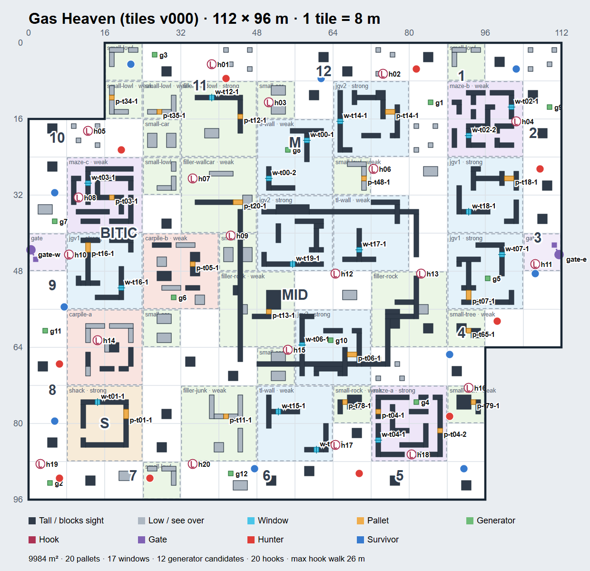
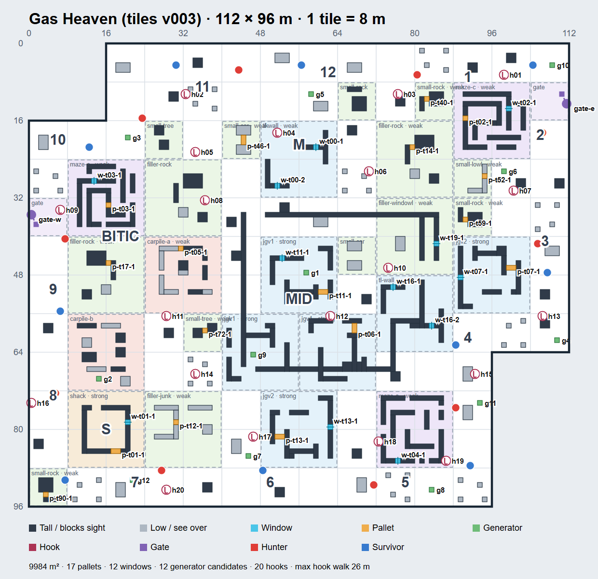

# Gas Heaven — tile-based variants

Generated by `node scripts/gen-maps.js --count 32 --seed 1` (this file is rewritten on every run).
Generator: `src/mapgen/` (tile library `tiles.js`, layout spec `layouts/gas-heaven.js`, pipeline `generate.js`). Variants: `maps/gas-heaven/vNNN.json`, listed in `maps/gas-heaven/index.json`. The hand-made v1 map `maps/gas-heaven.json` is unchanged.

## How a variant is built

1. 112 × 96 m outline on an 8 m grid (156 cells). Cells touching the outline form the outer **ring**; the rest is the **inner** area.
2. Fixed landmark slots (positions read off the reference overview): main building (x40–72, z8–40), shack (x24–40, z72–88), 3 mazetiles (88,8) (8,24) (72,72), 4 car piles (24,40) (56,56) (88,40) (8,56). Maze/car-pile *type* is rolled per slot. Every tile gets a random 90° rotation and mirror.
3. Two exit gates on ring cells along different outline edges ≥ 75 m apart.
4. Free inner 2×2 blocks get a 16 m loop tile with p=0.55 (jungle gyms, T+L, filler loops; repeated types are down-weighted); the remaining inner cells get 8 m small fillers or dead zones; ring cells mostly dead zones (trees, rocks, lone cars) with a few small fillers.
5. Optional pallets roll per tile (`p` groups) and car piles roll *one* of their numbered spots or none. If the total exceeds 24, random optional non-landmark pallets are removed; below 14 the seed is rejected.
6. 11–12 generator candidates chosen from tile generator slots (one always in main), spread ≥ ~20 m apart where possible.
7. Spawns: 10 survivor *anchors* and 10 hunter points spread around the whole perimeter, each 4–8 m inside the outline, outside landmarks; anchors need ≥ 75% walkable cells within 15 m (the engine scatters the 4 survivors within 15 m of the chosen anchor and picks a hunter point on the opposite side). Maps declare `spawnRules`, so the validator enforces the inset/walkable/open-space rules for them.
8. Hooks: exactly 20 hooks placed by simulated annealing so every walkable cell is within 26 m (4-neighbour walk, the validator's metric) of a hook; tile hook slots are preferred.

## Tile library

Pallet slots: G = guaranteed, O = optional groups (spawn chance in brackets), C = numbered choice spots (one spawns, chance in brackets). Rating = loop judgment used for the strong/weak counts below.

| Tile | Size | Category | Pallets G / O / C | Windows | Gen slots | Rating rule | Notes |
| --- | --- | --- | --- | --- | --- | --- | --- |
| `main` Main building (Gas Heaven style) | 32 m | landmark | 2 / 3 (60%) / 0 | 3 | 3 | strong | Roofless 24x20 m building. Interior N-S wall with the "incredibly safe" window: survivors vault in 0.5 s, the hunter detours ~18 m around the wall end. Complementary pallets: south pallet door (guaranteed), west door + east corridor + east-room pallets (optional), and a low-wall pallet outside the south wall. Two more windows (north, east) chain with the outside walls. |
| `shack` Shack | 16 m | landmark | 1 / 0 / 0 | 1 | 1 | strong | Square 10x10 m tall-walled shack: north door, east window, south-east pallet door. Loop: in the north door, out the window, around the outside, back in through the pallet. Hunter has to play reactively and force the pallet. |
| `maze-a` Mazetile A (box-in-box) | 16 m | maze | 0 / 3 (40%) / 0 | 1 | 1 | strong if windows+pallets ≥ 3, else weak | Outer broken box with an inner C; one window, up to three optional pallets. |
| `maze-b` Mazetile B (zig-zag) | 16 m | maze | 0 / 2 (45%) / 0 | 2 | 1 | strong if windows+pallets ≥ 3, else weak | Staggered tall walls; two windows, two optional pallets. |
| `maze-c` Mazetile C (corridors) | 16 m | maze | 0 / 2 (45%) / 0 | 1 | 1 | strong if windows+pallets ≥ 3, else weak | Long corridors and a pocket room; one window, two optional pallets. |
| `carpile-a` Car pile A (ring) | 16 m | carpile | 0 / 0 / 3 (75%) | 0 | 1 | weak if a pallet spawned, else none | Broken ring of low cars / tall stacks around a central stack. One of three pallet spots (75%). |
| `carpile-b` Car pile B (scattered stacks) | 16 m | carpile | 0 / 0 / 3 (70%) | 0 | 1 | weak if a pallet spawned, else none | Scattered rows and stacks; one of three pallet spots (70%). |
| `tl-wall` T + L wall | 16 m | loop | 0 / 0 / 0 | 2 | 1 | weak | T wall (window high in the stem) diagonal from an L wall (window low in the upright). Relatively unsafe alone: hunter double-backs on the T, the L is weaker. Strong when chained with neighbours. |
| `jgv1` Jungle Gym v1 | 16 m | loop | 1 / 0 / 0 | 1 | 1 | strong | L wall with window in the top run, corner pieces on the right, sideways-T inner wall ending in a pallet gap against the right wall. Hunter wants to force the pallet counter-clockwise; window stays strong-ish without the pallet. |
| `jgv2` Long-wall Jungle Gym v2 | 16 m | loop | 1 / 0 / 0 | 1 | 1 | strong | 13 m long wall with a window, bracket + short wall on the left, sideways-T with the pallet between the bracket and the T upright. "Good luck": hard to deal with without a power, crazier when chained. |
| `filler-wallcar` Filler: wall + car stack pallet | 16 m | filler | 0 / 1 (60%) / 0 | 0 | 1 | weak if a pallet spawned, else none | 8 m tall wall, pallet gap against a low car, low wall nearby. Weak filler loop. |
| `filler-rock` Filler: rock island | 16 m | filler | 0 / 1 (60%) / 0 | 0 | 1 | weak if a pallet spawned, else none | Tall rock + short tall wall with a pallet between, low rocks and a tree pair. Weak filler loop. |
| `filler-windowl` Filler: window L wall | 16 m | filler | 0 / 1 (60%) / 0 | 1 | 1 | strong with pallet, weak without | Tall L with a window in the top run and an optional pallet in the upright. Strong when the pallet spawns ("strong filler loops" critique). |
| `filler-junk` Filler: low-wall junk | 16 m | filler | 0 / 1 (55%) / 0 | 0 | 1 | weak if a pallet spawned, else none | Low walls and crates (all see-through), one optional pallet. Weak. |
| `small-lowl` Small: low L + pallet | 8 m | filler | 0 / 1 (55%) / 0 | 0 | 0 | weak if a pallet spawned, else none |  |
| `small-rock` Small: rock + wall pallet | 8 m | filler | 0 / 1 (55%) / 0 | 0 | 0 | weak if a pallet spawned, else none |  |
| `small-tree` Small: tree pallet | 8 m | filler | 0 / 1 (55%) / 0 | 0 | 0 | weak if a pallet spawned, else none |  |
| `small-car` Small: car pallet | 8 m | filler | 0 / 1 (55%) / 0 | 0 | 0 | weak if a pallet spawned, else none |  |
| `dead-empty` Dead zone: empty | 8 m | dead | 0 / 0 / 0 | 0 | 0 | none (dead) |  |
| `dead-gen` Dead zone: open (gen spot) | 8 m | dead | 0 / 0 / 0 | 0 | 1 | none (dead) |  |
| `dead-tree` Dead zone: tree | 8 m | dead | 0 / 0 / 0 | 0 | 1 | none (dead) |  |
| `dead-rocks` Dead zone: low rocks | 8 m | dead | 0 / 0 / 0 | 0 | 0 | none (dead) |  |
| `dead-car` Dead zone: lone car | 8 m | dead | 0 / 0 / 0 | 0 | 1 | none (dead) |  |
| `dead-tallrock` Dead zone: tall rock (no pallet) | 8 m | dead | 0 / 0 / 0 | 0 | 0 | none (dead) |  |
| `gate` Exit gate area | 8 m | gate | 0 / 0 / 0 | 0 | 0 | none (dead) |  |

## Per-variant stats

- **Dead tiles** = share of the 156 8 m cells covered by tiles rated "none" (dead zones, gate areas, fillers/car piles whose pallet did not spawn).
- **Dead zone** = share of walkable cells more than 12 m (walking) from any pallet or window.
- Loop counts are per tile instance (a main building counts once although it holds several loops).

| Variant | Pallets | Windows | Strong | Weak | Dead tiles | Dead zone | Gens | JG v1/v2 | T+L | Mazes | Car piles (pallet/none) | Gates |
| --- | --- | --- | --- | --- | --- | --- | --- | --- | --- | --- | --- | --- |
| v000 | 20 | 17 | 9 | 15 | 50% | 33% | 12 | 3/3 | 3 | BCA | 1/1 | gate-w gate-e |
| v001 | 17 | 16 | 7 | 16 | 51% | 39% | 12 | 2/2 | 2 | CCB | 2/0 | gate-e gate-w |
| v002 | 19 | 15 | 9 | 13 | 53% | 37% | 12 | 2/3 | 2 | ABC | 2/0 | gate-n gate-s |
| v003 | 17 | 12 | 6 | 16 | 55% | 44% | 12 | 3/2 | 2 | CCA | 1/1 | gate-e gate-w |
| v004 | 19 | 14 | 7 | 14 | 60% | 39% | 12 | 1/2 | 2 | CBB | 1/1 | gate-e gate-w |
| v005 | 21 | 11 | 7 | 15 | 59% | 39% | 12 | 2/2 | 1 | ACB | 1/1 | gate-w gate-n |
| v006 | 16 | 17 | 7 | 13 | 56% | 38% | 12 | 2/2 | 4 | ACB | 1/1 | gate-e gate-n |
| v007 | 15 | 15 | 4 | 18 | 55% | 44% | 12 | 1/2 | 3 | CAB | 2/0 | gate-w gate-n |
| v008 | 19 | 14 | 6 | 16 | 57% | 38% | 12 | 1/2 | 3 | CAA | 0/2 | gate-e gate-n |
| v009 | 19 | 15 | 7 | 16 | 58% | 38% | 11 | 3/2 | 3 | AAB | 2/0 | gate-e gate-w |
| v010 | 20 | 15 | 9 | 11 | 55% | 37% | 11 | 3/1 | 3 | CBA | 2/0 | gate-w gate-e |
| v011 | 15 | 11 | 6 | 10 | 69% | 49% | 12 | 2/1 | 2 | ACA | 1/1 | gate-e gate-s |
| v012 | 18 | 15 | 7 | 16 | 58% | 47% | 11 | 3/1 | 3 | ABC | 0/2 | gate-e gate-w |
| v013 | 16 | 16 | 7 | 13 | 55% | 40% | 11 | 3/1 | 3 | CBA | 1/1 | gate-s gate-e |
| v014 | 21 | 15 | 8 | 15 | 56% | 35% | 11 | 3/2 | 3 | AAC | 0/2 | gate-s gate-w |
| v015 | 15 | 13 | 6 | 12 | 64% | 44% | 11 | 1/1 | 3 | BCA | 1/1 | gate-e gate-s |
| v016 | 20 | 14 | 8 | 15 | 55% | 36% | 11 | 3/3 | 2 | BAC | 2/0 | gate-w gate-n |
| v017 | 18 | 17 | 5 | 19 | 50% | 37% | 12 | 2/1 | 4 | CCB | 2/0 | gate-n gate-w |
| v018 | 15 | 15 | 8 | 10 | 58% | 43% | 11 | 3/2 | 2 | CCA | 1/1 | gate-e gate-s |
| v019 | 21 | 16 | 10 | 13 | 47% | 32% | 12 | 3/1 | 4 | BCC | 2/0 | gate-s gate-n |
| v020 | 17 | 15 | 7 | 13 | 58% | 39% | 12 | 2/2 | 2 | CBA | 1/1 | gate-w gate-s |
| v021 | 18 | 14 | 8 | 12 | 62% | 41% | 11 | 2/1 | 2 | ABC | 2/0 | gate-e gate-n |
| v022 | 19 | 15 | 7 | 16 | 55% | 34% | 12 | 2/1 | 3 | BBA | 0/2 | gate-e gate-n |
| v023 | 14 | 11 | 6 | 9 | 67% | 50% | 12 | 2/1 | 1 | BAC | 0/2 | gate-w gate-n |
| v024 | 18 | 16 | 7 | 16 | 56% | 39% | 12 | 3/1 | 3 | BCB | 1/1 | gate-s gate-n |
| v025 | 16 | 15 | 8 | 12 | 58% | 38% | 12 | 2/2 | 3 | BAB | 1/1 | gate-w gate-n |
| v026 | 15 | 13 | 7 | 13 | 55% | 44% | 12 | 3/2 | 3 | AAB | 2/0 | gate-w gate-s |
| v027 | 20 | 16 | 9 | 14 | 58% | 35% | 12 | 2/3 | 2 | ABB | 1/1 | gate-e gate-w |
| v028 | 21 | 14 | 7 | 19 | 49% | 36% | 12 | 3/2 | 2 | CBC | 2/0 | gate-n gate-s |
| v029 | 21 | 13 | 6 | 19 | 49% | 36% | 11 | 2/2 | 2 | ACB | 2/0 | gate-n gate-e |
| v030 | 18 | 11 | 6 | 14 | 62% | 40% | 12 | 2/2 | 2 | ABC | 0/2 | gate-e gate-n |
| v031 | 14 | 15 | 4 | 18 | 55% | 41% | 12 | 2/1 | 3 | BAC | 1/1 | gate-e gate-s |

### Spread across the pool

| Stat | Min | Mean | Max |
| --- | --- | --- | --- |
| Pallets | 14.0 | 17.9 | 21.0 |
| Windows | 11.0 | 14.4 | 17.0 |
| Strong loops | 4.0 | 7.0 | 10.0 |
| Weak loops | 9.0 | 14.4 | 19.0 |
| Dead tiles | 47% | 56% | 69% |
| Dead zone | 32% | 39% | 50% |

Hand-made v1 for comparison: 14 pallets, 9 windows.

## Renders

First 4 variants in `docs/maps/gas-heaven-tiles/` (tinted rectangles = tile footprints: tan landmark, purple maze, red car pile, blue loop, green filler; dashed outline + name on non-dead tiles).

- [v000](gas-heaven-tiles/v000.svg) · 
- [v001](gas-heaven-tiles/v001.svg) · 
- [v002](gas-heaven-tiles/v002.svg) · 
- [v003](gas-heaven-tiles/v003.svg) · 
