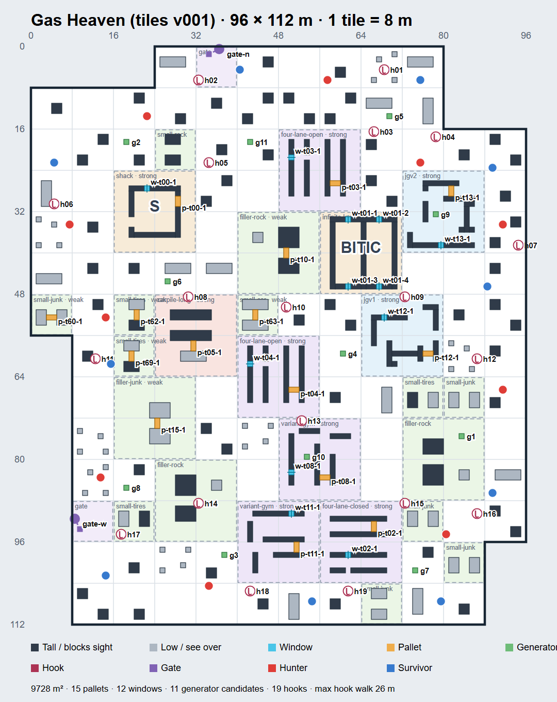
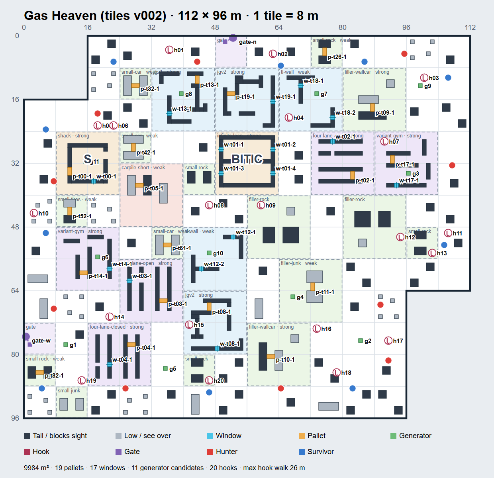

# Gas Heaven — tile-based variants

Generated by `node scripts/gen-maps.js --count 32 --seed 1` (this file is rewritten on every run).
Generator: `src/mapgen/` (tile library `tiles.js`, layout spec `layouts/gas-heaven.js`, pipeline `generate.js`). Variants: `maps/gas-heaven/vNNN.json`, listed in `maps/gas-heaven/index.json`. The hand-made v1 map `maps/gas-heaven.json` is unchanged.

## How a variant is built

1. 112 × 96 m outline on an 8 m grid (156 cells). Cells touching the outline form the outer **ring**; the rest is the **inner** area.
   **Shaped variants** (`--shaped odd`; default: every odd variant): the outline is instead a seeded stepped polygon from `src/mapgen/outline.js` — 144–153 tiles (9216–9792 m²), aspect ≤ 1.6, min width 4 tiles everywhere, no holes; families round-robin: notched, circlish, blob, chunky. Fixed pieces keep their slot when it fits inside, else move to the nearest free tile slot (`fitLayoutToOutline`; the MID enclosure moves as one piece with its jungle gym); pallet and hook budgets scale with area. The Outline column below names the family.
2. No fixed placements: one shack (any rotation, never mirrored), one infinite-loop probe (canary), three maze-pool tiles and one car pile go to random free inner slots per seed.
3. Two exit gates on ring cells along different outline edges ≥ 75 m apart.
4. Free inner 2×2 blocks get a 16 m loop tile with p=0.55 (jungle gyms, T+L, filler loops; repeated types are down-weighted); the remaining inner cells get 8 m small fillers or dead zones; ring cells mostly dead zones (trees, rocks, lone cars) with a few small fillers.
5. Optional pallets roll per tile (`p` groups) and car piles roll *one* of their numbered spots or none. If the total exceeds 24, random optional non-landmark pallets are removed; below 14 the seed is rejected.
6. 11-12 generator candidates chosen from authored tile slots, at most one per tile, all pairs at least 20 m apart and all at least 6 m from the outline. Every slot has a clear 3x3 floor footprint. Failed packings restart instead of relaxing spacing. Shack has an optional indoor slot. Match selection uniformly samples feasible seven-gen subsets: pairs at least 24 m apart, triple perimeters at least 80 m, every candidate within 40 m of a selected gen (Euclidean). See docs/research/gen-placement.md for evidence and simulation-specific thresholds.
7. Spawns: 10 survivor *anchors* and 10 hunter points spread around the whole perimeter, each 4–8 m inside the outline, outside landmarks; anchors need ≥ 75% walkable cells within 15 m (the engine scatters the 4 survivors within 15 m of the chosen anchor and picks a hunter point on the opposite side). Maps declare `spawnRules`, so the validator enforces the inset/walkable/open-space rules for them.
8. Hooks: exactly 20 hooks placed by simulated annealing so every walkable cell is within 26 m (4-neighbour walk, the validator's metric) of a hook; tile hook slots are preferred.

## Tile library

Pallet slots: G = guaranteed, O = optional groups (spawn chance in brackets), C = numbered choice spots (one spawns, chance in brackets). Rating = loop judgment used for the strong/weak counts below. Pallet safety = isolated dropped pallet against an M1 killer; these judgments do not change engine rules. Window-only T+Ls are not pallet loops. See docs/research/tile-accuracy.md for the audit and source limitations.

| Tile | Size | Category | Pallets G / O / C | Windows | Gen slots | Rating rule | Pallet safety | Notes |
| --- | --- | --- | --- | --- | --- | --- | --- | --- |
| `shack` Shack | 16 m | landmark | 1 / 0 / 0 | 1 | 1 | strong | god | Square 10x10 m tall-walled shack: north door, east window, south-east pallet door. Loop: in the north door, out the window, around the outside, back in through the pallet. Hunter has to play reactively and force the pallet. |
| `pallet-gym` Pallet gym (C + L walls) | 16 m | maze | 1 / 0 / 0 | 0 | 1 | strong with pallet, otherwise none | safe | Long C wall and short L joined by one 2 m pallet gap; separate rear C and straight wall. No window. Walls span 10 m / 6 m in this grid approximation. |
| `four-lane-open` Four-lane gym (outside window) | 16 m | maze | 1 / 0 / 0 | 1 | 1 | strong with window or pallet | safe | Four parallel 11 m walls, outside window and hole in the adjacent inside wall. One 2 m pallet between the opposite pair of windowless walls. |
| `four-lane-closed` Four-lane gym (inside window) | 16 m | maze | 1 / 0 / 0 | 1 | 1 | strong with pallet, weak with window only | safe | Same four-lane footprint; inside window, outside hole. Window alone is more mindgameable than the open variant. |
| `carpile-long` Car pile: long stack + wreck | 16 m | carpile | 0 / 0 / 2 (80%) | 0 | 1 | strong with pallet, otherwise none | safe | Two separated 2x8 m stacks, one 2x5 m wreck. One of two 2 m pallet gaps (80%); open routes through and around the piles. |
| `carpile-short` Car pile: scattered wrecks | 16 m | carpile | 0 / 0 / 2 (75%) | 0 | 1 | weak if a pallet spawned, else none | unsafe | Three 2x5 m wrecks, one tall. One of two 2 m pallet gaps (75%). Shorter, visible loops; no free-standing pallet or one-cell car posts. |
| `tl-wall` T + L wall | 16 m | loop | 0 / 0 / 0 | 2 | 1 | weak | n/a | T wall (window high in the stem) diagonal from an L wall (window low in the upright). Relatively unsafe alone: hunter double-backs on the T, the L is weaker. Strong when chained with neighbours. |
| `jgv1` Jungle Gym v1 | 16 m | loop | 1 / 0 / 0 | 1 | 1 | strong | safe | L wall with window in the top run, corner pieces on the right, sideways-T inner wall ending in a pallet gap against the right wall. Hunter wants to force the pallet counter-clockwise; window stays strong-ish without the pallet. |
| `jgv2` Long-wall Jungle Gym v2 | 16 m | loop | 1 / 0 / 0 | 1 | 1 | strong | safe | 13 m long wall with a window, bracket + short wall on the left, sideways-T with the pallet between the bracket and the T upright. "Good luck": hard to deal with without a power, crazier when chained. |
| `filler-wallcar` Filler: stack + car pallet | 16 m | filler | 0 / 1 (65%) / 0 | 0 | 1 | strong with pallet, otherwise none | safe | 2x7 m tall scrap stack beside a 2x5 m low car; optional 2 m pallet between their long sides. Autohaven long filler rather than an 8 m wall ending in a tiny car. |
| `filler-rock` Filler: paired rock pallet | 16 m | filler | 0 / 1 (65%) / 0 | 0 | 1 | weak if a pallet spawned, else none | unsafe | 4x4 m and 3x4 m LOS-blocking rock clusters joined by an optional 2 m pallet; no window invented in natural rock. Unsafe alone but can chain into a nearby gym. |
| `variant-gym` Variant jungle gym | 16 m | maze | 1 / 0 / 0 | 1 | 1 | strong with pallet, weak with window only | safe | Five separate wall segments: 10 m left wall with window near its front, central and right walls with a 2 m pallet at the front, two rear segments. One window and one guaranteed pallet. |
| `filler-junk` Filler: tires + scrap pallet | 16 m | filler | 0 / 1 (60%) / 0 | 0 | 1 | weak if a pallet spawned, else none | unsafe | Two low 3x4 m junk/tyre islands with a 2 m pallet gap. Short visible filler; no zig-zag low-wall maze. |
| `small-junk` Small: crate + tires pallet | 8 m | filler | 0 / 1 (55%) / 0 | 0 | 0 | weak if a pallet spawned, else none | unsafe | Two 2x3 m low prop groups, 2 m gap; unsafe edge filler. |
| `small-rock` Small: paired rock pallet | 8 m | filler | 0 / 1 (55%) / 0 | 0 | 0 | weak if a pallet spawned, else none | unsafe | Two 2x3 m rocks with a 2 m pallet gap; unsafe, not a rock against a one-cell post. |
| `small-tires` Small: tire stacks pallet | 8 m | filler | 0 / 1 (55%) / 0 | 0 | 0 | weak if a pallet spawned, else none | unsafe | Two 2x3 m tyre/scrap groups, one tall and one low; unsafe, not an isolated tree pallet. |
| `small-car` Small: car pallet | 8 m | filler | 0 / 1 (55%) / 0 | 0 | 0 | weak if a pallet spawned, else none | unsafe | Two 2x5 m low cars with a 2 m pallet gap, a visible and mindgameable Autohaven filler. |
| `dead-empty` Dead zone: empty | 8 m | dead | 0 / 0 / 0 | 0 | 0 | none (dead) | n/a |  |
| `dead-gen` Dead zone: open (gen spot) | 8 m | dead | 0 / 0 / 0 | 0 | 1 | none (dead) | n/a |  |
| `dead-tree` Dead zone: tree | 8 m | dead | 0 / 0 / 0 | 0 | 1 | none (dead) | n/a |  |
| `dead-rocks` Dead zone: low rocks | 8 m | dead | 0 / 0 / 0 | 0 | 0 | none (dead) | n/a |  |
| `dead-car` Dead zone: lone car | 8 m | dead | 0 / 0 / 0 | 0 | 1 | none (dead) | n/a |  |
| `dead-tallrock` Dead zone: tall rock (no pallet) | 8 m | dead | 0 / 0 / 0 | 0 | 0 | none (dead) | n/a |  |
| `dead-tallrock2` Dead zone: two small tall rocks (no pallet, set apart) | 8 m | dead | 0 / 0 / 0 | 0 | 0 | none (dead) | n/a |  |
| `infinite-loop` Infinite loop (deliberately game-breaking) | 16 m | landmark | 0 / 0 / 0 | 4 | 0 | strong (owner test probe) | n/a | User probe tile: two sealed 12 m corridors between three tall walls, a window in each end wall (4 windows). Survivors fast-vault (0.5 s) vs the hunter (1.7 s) and gain more per vault than the hunter gains per corridor run. Tests whether survivors learn to exploit it. |
| `gate` Exit gate area | 8 m | gate | 0 / 0 / 0 | 0 | 0 | none (dead) | n/a |  |

## Per-variant stats

- **Dead tiles** = share of the 156 8 m cells covered by tiles rated "none" (dead zones, gate areas, fillers/car piles whose pallet did not spawn).
- **Dead zone** = share of walkable cells more than 12 m (walking) from any pallet or window.
- Loop counts are per tile instance (the preserved probe counts once although it holds four windows).

| Variant | Outline | Pallets | Windows | Strong | Weak | Dead tiles | Dead zone | Gens | JG v1/v2 | T+L | Mazes | Car piles (pallet/none) | Gates |
| --- | --- | --- | --- | --- | --- | --- | --- | --- | --- | --- | --- | --- | --- |
| v000 | base | 21 | 16 | 11 | 13 | 54% | 32% | 11 | 3/2 | 2 | pallet-gym, four-lane-open, pallet-gym, variant-gym | 0/1 | gate-n gate-e |
| v001 | notched 96×112 (9728 m²) | 15 | 12 | 10 | 6 | 66% | 52% | 11 | 1/1 | 0 | four-lane-closed, four-lane-open, four-lane-open, variant-gym, variant-gym | 1/0 | gate-w gate-n |
| v002 | base | 19 | 17 | 12 | 10 | 55% | 38% | 11 | 1/2 | 2 | four-lane-open, four-lane-open, four-lane-closed, variant-gym, variant-gym | 1/0 | gate-w gate-n |
| v003 | circlish 88×120 (9536 m²) | 17 | 16 | 10 | 10 | 58% | 40% | 12 | 3/1 | 2 | four-lane-closed, pallet-gym, four-lane-closed, variant-gym | 1/0 | gate-w gate-e |
| v004 | base | 18 | 15 | 10 | 10 | 62% | 41% | 12 | 3/1 | 1 | four-lane-open, four-lane-closed, four-lane-closed, variant-gym | 1/0 | gate-e gate-n |
| v005 | blob 96×112 (9216 m²) | 19 | 12 | 10 | 11 | 56% | 37% | 11 | 2/0 | 1 | four-lane-closed, four-lane-open, pallet-gym, variant-gym | 1/0 | gate-e gate-w |
| v006 | base | 17 | 16 | 10 | 10 | 58% | 42% | 12 | 2/1 | 2 | four-lane-closed, four-lane-closed, pallet-gym, variant-gym, variant-gym | 1/0 | gate-n gate-s |
| v007 | chunky 128×80 (9600 m²) | 20 | 13 | 11 | 10 | 60% | 40% | 12 | 3/2 | 0 | four-lane-closed, four-lane-closed, pallet-gym, variant-gym | 0/1 | gate-n gate-s |
| v008 | base | 22 | 15 | 11 | 13 | 58% | 34% | 11 | 2/3 | 1 | four-lane-open, four-lane-closed, pallet-gym, variant-gym | 1/0 | gate-n gate-w |
| v009 | notched 120×88 (9792 m²) | 14 | 16 | 12 | 5 | 60% | 45% | 12 | 2/1 | 2 | pallet-gym, four-lane-open, four-lane-closed, variant-gym, variant-gym | 1/0 | gate-s gate-n |
| v010 | base | 17 | 16 | 11 | 10 | 56% | 38% | 11 | 2/1 | 3 | pallet-gym, four-lane-closed, four-lane-closed | 0/1 | gate-w gate-e |
| v011 | circlish 96×112 (9472 m²) | 21 | 14 | 8 | 16 | 57% | 38% | 11 | 1/1 | 2 | four-lane-open, four-lane-closed, pallet-gym, variant-gym | 1/0 | gate-s gate-n |
| v012 | base | 14 | 15 | 11 | 6 | 62% | 46% | 11 | 0/2 | 2 | four-lane-closed, four-lane-open, pallet-gym, variant-gym, variant-gym | 1/0 | gate-w gate-e |
| v013 | blob 112×112 (9280 m²) | 22 | 10 | 9 | 14 | 59% | 34% | 11 | 1/1 | 0 | four-lane-open, four-lane-open, pallet-gym, variant-gym | 1/0 | gate-n gate-s |
| v014 | base | 16 | 17 | 13 | 6 | 59% | 39% | 11 | 2/2 | 2 | four-lane-open, pallet-gym, four-lane-closed, variant-gym, variant-gym | 0/1 | gate-s gate-w |
| v015 | chunky 80×128 (9216 m²) | 17 | 16 | 9 | 12 | 56% | 42% | 11 | 1/1 | 3 | pallet-gym, four-lane-closed, four-lane-open, variant-gym | 1/0 | gate-n gate-s |
| v016 | base | 17 | 12 | 10 | 9 | 63% | 44% | 11 | 3/1 | 1 | pallet-gym, pallet-gym, four-lane-closed | 1/0 | gate-s gate-n |
| v017 | notched 104×96 (9344 m²) | 19 | 15 | 12 | 9 | 53% | 39% | 11 | 3/2 | 1 | pallet-gym, four-lane-closed, four-lane-closed, variant-gym | 1/0 | gate-w gate-s |
| v018 | base | 17 | 19 | 12 | 9 | 56% | 36% | 11 | 1/3 | 3 | four-lane-open, four-lane-open, pallet-gym, variant-gym, variant-gym | 1/0 | gate-e gate-w |
| v019 | circlish 120×88 (9536 m²) | 18 | 16 | 11 | 10 | 54% | 37% | 12 | 2/0 | 2 | four-lane-closed, four-lane-closed, four-lane-closed, variant-gym, variant-gym | 1/0 | gate-n gate-w |
| v020 | base | 17 | 18 | 12 | 8 | 58% | 36% | 11 | 2/1 | 2 | four-lane-open, four-lane-open, four-lane-open, variant-gym, variant-gym, variant-gym | 1/0 | gate-s gate-n |
| v021 | blob 120×88 (9664 m²) | 16 | 15 | 11 | 8 | 60% | 42% | 11 | 1/1 | 2 | pallet-gym, four-lane-open, four-lane-closed, variant-gym, variant-gym | 1/0 | gate-s gate-n |
| v022 | base | 23 | 17 | 10 | 17 | 52% | 35% | 12 | 2/1 | 3 | four-lane-open, four-lane-closed, pallet-gym, variant-gym | 1/0 | gate-n gate-w |
| v023 | chunky 104×120 (9600 m²) | 18 | 14 | 7 | 14 | 62% | 41% | 11 | 1/1 | 2 | four-lane-open, four-lane-open, four-lane-closed | 0/1 | gate-s gate-w |
| v024 | base | 18 | 14 | 11 | 9 | 58% | 38% | 12 | 2/2 | 1 | four-lane-open, pallet-gym, four-lane-closed, variant-gym | 1/0 | gate-w gate-e |
| v025 | notched 88×120 (9472 m²) | 15 | 15 | 11 | 7 | 57% | 45% | 11 | 2/1 | 2 | pallet-gym, four-lane-open, four-lane-closed, variant-gym | 1/0 | gate-e gate-s |
| v026 | base | 15 | 16 | 12 | 6 | 62% | 43% | 11 | 2/2 | 2 | four-lane-open, pallet-gym, four-lane-closed, variant-gym | 1/0 | gate-n gate-w |
| v027 | circlish 104×104 (9536 m²) | 21 | 9 | 8 | 14 | 61% | 41% | 11 | 1/0 | 0 | pallet-gym, four-lane-open, four-lane-closed, variant-gym | 1/0 | gate-w gate-e |
| v028 | base | 15 | 19 | 12 | 7 | 57% | 36% | 11 | 3/1 | 3 | four-lane-open, four-lane-open, four-lane-open, variant-gym | 1/0 | gate-e gate-s |
| v029 | blob 96×104 (9216 m²) | 18 | 13 | 12 | 8 | 55% | 35% | 11 | 3/0 | 1 | four-lane-open, four-lane-closed, pallet-gym, variant-gym | 1/0 | gate-s gate-n |
| v030 | base | 17 | 12 | 10 | 9 | 63% | 41% | 11 | 2/0 | 1 | pallet-gym, four-lane-open, four-lane-open, variant-gym | 0/1 | gate-e gate-n |
| v031 | chunky 112×88 (9344 m²) | 16 | 17 | 10 | 10 | 51% | 37% | 12 | 2/0 | 3 | four-lane-open, four-lane-closed, pallet-gym, variant-gym, variant-gym | 1/0 | gate-w gate-s |

### Spread across the pool

| Stat | Min | Mean | Max |
| --- | --- | --- | --- |
| Pallets | 14.0 | 17.8 | 23.0 |
| Windows | 9.0 | 14.9 | 19.0 |
| Strong loops | 7.0 | 10.6 | 13.0 |
| Weak loops | 5.0 | 9.9 | 17.0 |
| Safe pallets | 5.0 | 8.6 | 11.0 |
| Unsafe pallets | 3.0 | 8.2 | 14.0 |
| God pallets | 1.0 | 1.0 | 1.0 |
| Dead tiles | 51% | 58% | 66% |
| Dead zone | 32% | 39% | 52% |

Hand-made v1 for comparison: 14 pallets, 9 windows.

## Renders

First 4 variants in `docs/maps/gas-heaven-tiles/` (tinted rectangles = tile footprints: tan landmark, purple maze, red car pile, blue loop, green filler; dashed outline + name on non-dead tiles).

- [v000](gas-heaven-tiles/v000.svg) · 
- [v001](gas-heaven-tiles/v001.svg) · 
- [v002](gas-heaven-tiles/v002.svg) · 
- [v003](gas-heaven-tiles/v003.svg) · 
