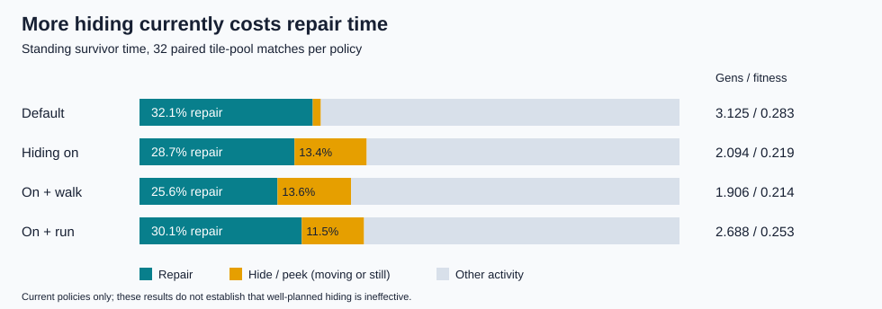

# Survivor hiding: information, decisions and discoverability

Review date: **2026-11-16**. Audited and measured source: **`27157b588fcdec95090bccab08fd2745c5193fcc`**. Branch: `review/hiding`. This is a report and read-only diagnostic change; no runtime brain, engine, scoring, map or evolution rule is changed. The concurrent kicked-generator hiding work and chase/heal/rescue/gen-choice edits are outside this patch.

## Summary

**Yes: survivors need a route-level prediction of detection, rather than substantially more privileged observations.** They already have geometry, LOS queries, their own last hunter sighting/velocity/facing, delayed terror layers and a private hunter belief. None of the hiding paths asks whether a walking survivor reaches concealment before the approaching hunter can see the *moving survivor*. Evolution cannot construct that comparison from existing scalar thresholds.

The highest-value changes are:

1. Forecast exposure along a short route against several plausible hunter approaches; compare walking, running and remaining at the generator. Preserve uncertainty and evidence age.
2. Choose gait per encounter, accounting for the marks already left and the additional trail running creates. Fix the unblocking sidestep that silently drops `walk`.
3. Score the correct side of cover along the hunter's likely route, then keep watching/repositioning and return to the original task when the danger passes.
4. Evaluate the resulting policy with the existing **time-weighted survival** fitness, paired seeds and several hunters. Do not infer that hiding itself is ineffective from the current policy's performance.

On 32 tile-pool seeds, switching unseen-hunter hiding on reduces completed gens **3.125 → 2.094** and current survivor fitness **0.2830 → 0.2188**. Hiding/peeking grows **1.51% → 13.37%** of standing survivor time. Making these hides run to cover improves gens to **2.688**, despite creating marks. This is evidence that the current timing/selection policy is inadequate, not proof that running is always preferable. Of 130 baseline gen departures classified as stealth, **100 already have the survivor in the hunter's view** at departure: much of the apparent stealth is too late to prevent discovery.



## What real DBD stealth is doing

### Leave early enough, using the fastest gait that preserves the plan

Base movement is **4 m/s running, 2.26 m/s walking, 1.13 m/s crouching**. Walking and crouching do not generate scratch marks; crouching is half walking speed, not a universally better way to travel. Healthy players can walk quickly to a tall blocker, then crouch only where reduced silhouette matters. Running can be correct when the killer already knows the position, the cover deadline is otherwise missed, or distance to a usable loop matters more than concealing the departure. [Movement speeds](https://deadbydaylight.wiki.gg/wiki/Movement_speed)

Scratch marks last about **10 seconds** and can appear on nearby walls/objects. Starting to walk does not erase the run into the generator or another survivor's trail. Walking after breaking LOS can conceal a change of direction; a player may double back along an existing trail before quietly branching off. Players explicitly warn that walking to a hiding spot takes time while the killer advances much faster. This supports a route/deadline decision rather than an unconditional walk-in-terror rule. [Scratch marks](https://deadbydaylight.wiki.gg/wiki/Scratch_Marks), [player hiding discussion](https://www.reddit.com/r/deadbydaylight/comments/1ail36d/im_a_hider_not_a_fighter/)

An illustrative calculation, **not a measured live-game reaction guarantee**: if the killer is 20 path-metres from the corner that opens LOS, a 4.6 m/s approach takes 4.35 s. A survivor needing 8 m to get behind a blocker takes 3.54 s walking, 2.00 s running, or 7.08 s crouching. Walking has only 0.81 s slack before allowing for reaction and uncertainty. If the killer is only 12 m from that corner, walking loses this race while running may win. Distance from killer to survivor divided by killer speed is the wrong deadline: the relevant point is the first opening in the occlusion geometry.

### Infer approach direction; terror radius is not a compass

Heartbeat intensity/pace and music layers convey proximity. The three proximity layers are distinct from chase music. A rising cue suggests closing distance, but does not uniquely identify bearing or intent. Ordinary terror radius is non-directional; players combine last sightings, known entrances, likely patrol routes, nearby generators, HUD chase activity and close directional sounds. [Terror radius](https://deadbydaylight.wiki.gg/wiki/Terror_Radius), [directionality discussion](https://forums.bhvr.com/dead-by-daylight/discussion/comment/3483652/)

The red stain can appear around a corner before the killer's body and indicates facing; moonwalking/sideways movement can disguise it. A player should treat this as local visual evidence, not an exact hidden position or a guarantee of travel direction. [Red stain](https://deadbydaylight.wiki.gg/wiki/Stain)

Choose cover before the approach: tall rocks/walls block body LOS, while a low wall may require crouching and the correct side. Corners can hide the body while third-person camera peeks around them. Continue moving around the blocker as the killer changes angle when necessary. A stealth guide specifically recommends anticipating approaches from the map centre or another generator and rejects crouch-walking across the killer's view. Its perk advice is dated; only the geometric reasoning is used here. [Stealth guide, 2021/2022](https://eip.gg/dbd/guides/sneaky-survivor-build/)

“Hiding in plain sight” can exploit a busy killer's attention, small silhouette, dark clothing or vegetation. Those effects are not equivalent to being geometrically invisible: standing still on an exposed cell does not make the sim ignore the survivor. Player anecdotes describe killers passing motionless survivors in bushes/corners, but do not establish a universal detection probability. Lockers are excluded from this review's recommendations. [Stealth playstyle discussion](https://forums.bhvr.com/dead-by-daylight/discussion/comment/3338556)

### Wait, observe, then become productive again

Hiding is especially valuable before a killer without a chase target commits, on death hook/injured in a weak or exhausted tile, or while waiting for a safe gate opening/rescue opportunity. Once already identified at short range, wasting distance by crouching or walking can be worse than looping. If another survivor has safely occupied the killer, keep repairing when the approach is not threatening you. This is situational reasoning, not a claim that every weak tile or endgame should be hidden through. Community discussion explicitly distinguishes dead-zone caution from hiding while teammates need pressure. [Dead-zone advice](https://www.reddit.com/r/deadbydaylight/comments/1dhy0sk/how_to_counter_silent_killers/), [solo-queue stealth debate](https://www.reddit.com/r/deadbydaylight/comments/1s85lsi/does_anyone_else_actually_enjoy_playing_the/)

After the killer passes, check that its path and attention are moving away, then repair again. A fading heartbeat alone can be bait: killers can double back and catch the return. Searching around a worked gen, checking plausible cover from the arrival angle, and following sound/traces are normal counters. Breathing and injured vocalizations make close hiding risky even without marks. [Killer search/return guide](https://eip.gg/dbd/guides/how-to-find-hiding-survivors/)

Ordinary crows provide local sound/visual evidence of disturbance or return; either role can disturb them. Walking can still trigger them; crouching avoids ordinary triggers unless too close. AFK crows are a separate inactivity counter, not an automatic perk-free location alert for every disturbed bird. Blood pools also betray injured survivors who walk. [Crows](https://deadbydaylight.wiki.gg/wiki/Crows), [blood pools](https://deadbydaylight.wiki.gg/wiki/Pools_of_Blood)

**Expert-source limitation:** Otzdarva's own [beginner-guide index](https://www.otzdarva.com/dbd/beginner-guides) and [resource site](https://www.otzdarva.com/) were checked. Video transcripts were not available, so no specific stealth timing or technique is attributed to an unwatched Otz/Hens video. Accessible wiki, guide and practitioner evidence above supports the actual claims. Wiki direct opens sometimes returned 403; indexed page passages were available. Anecdotes and old guides are not used to override the owner's confirmed rules.

## Audit: available information versus missing estimates

References below are repository-relative to the audited commit; several leading comments still describe old 360-degree vision, but executable code uses the current camera.

| Information/estimate | Current implementation | Assessment |
|---|---|---|
| Visible hunter position, velocity, facing and action | `match.js` `_obsSurvivor`; `lastHunter` stores position/velocity/facing/time from own sightings | Enough for a short observed-motion prediction; hidden hunter goal/true position must stay private. |
| Unseen hunter position belief | `hunterbelief.js`: private 4 m cells; sight fix, short velocity carry after loss, diffusion, terror band likelihoods, hooks/downed auras and own teammate sightings + HUD chase; camera-based negative evidence | Valuable existing input. A probability distribution over position is not a forecast of path or facing. Heavy update is requested every 2 s, with fixes/layer changes sooner. |
| Terror trend | `layerHist`, `trend(now, 4)` gives closing/receding/none | Already exists. Delayed bands yield weak timing; no bearing should be fabricated. Own movement can cause a layer change too. |
| Static cover | `coverAt`: average concealment over 16 directions out to 24 m | Measures general enclosure, not protection from the likely approach. |
| Directional exposure | `exposure`: LOS from top 12 belief cells, renormalized; ignores facing. `hideGenFear` adds the worked generator as a possible hunter viewpoint | Direction-aware **now**, with one endpoint proxy for the future. It does not simulate travelling to/around the gen. Top-K renormalization also discards how little total probability those cells may contain. |
| Camera peeking | `peekValue` checks body hidden from target viewpoints and camera visibility; considers visible hunter now and 1.5 s ahead, or top 4 belief cells | Real useful asymmetry. The future endpoint affects peek value, not transit safety or arrival deadline. Mean target direction can be poor for a multi-modal belief. |
| Route reachability | `walkClear` and nav APIs are available | Hide candidates accept straight-line paths only. No walk/run travel-time or intermediate visibility evaluation. |
| Resources and gen knowledge | `mapknow.js` tracks personally observed loop anchors/exploration; only found gens have coordinates in `obs.gens` | Keep solo queue and discovery intact. Static collision/cover geometry is already available under the current contract. |
| Own exposure history | Own actions/positions can be remembered; `self.chased` is chase music | No private recent-trail estimate, last-likely-exposed point, or “killer probably knows I was on this gen” estimate. No legal observation says whether the hunter really sees me. |
| Close approach cues | No stain footprint, killer footstep/attack direction or graded close-audio observation | Actual missing channels, separate from the prediction/planning work. |

**Direct answer:** no code computes time-to-cover versus time-until-hunter-LOS from sightings, terror trend or belief. `findHide` has a 1.5 s future *peek* target; `HunterBelief.update` carries a last velocity briefly after sight loss. Neither compares arrival times. The chase modules' route/race logic does not supply this missing stealth decision.

## Audit: what each stealth path actually decides

### 1. Threat mode and “sneak” (`survivor.js`, threat-state block and `mode === 'sneak'`)

`self.chased` or a visible hunter closer than `fleeSeenDist` starts chase mode. An unseen hunter with terror midpoint below `fleeTR` can start sneak, unless another survivor is chased and `trustChase` is enabled. `calmS` and `sneakMaxS` eventually restore work.

Sneak chooses the **farthest known unfinished gen from the last sighting**, with a distance cost from self, then calls `slots.act`. Without a last sighting, the reference is self. This is relocation to another objective, not cover selection. It can even repair while the mode is named sneak. With only one found gen, that gen can win again. `walkWhenTR > .5` chooses walking whenever terror is present; its default is exactly **.5**, so defaults run. The flag also affects other generator travel using the same `walk` variable. There is no explicit running-trace cost versus walking-capture risk.

The three midpoint values are approximately **26.7 / 16 / 5.3 m**. Default `fleeTR = 12` reacts only to the innermost heard layer, which itself requires **2.5 s persistence** when changing from an existing layer. A 4.6 m/s hunter can advance **11.5 m** in that lag. Entry uses 0.5 s. These are intentional model timings, not reasons to silently expose exact distance; they make a late threshold a poor early-warning plan.

### 2. Visible-hunter hiding (`findHide`, `hunterCouldSee`, visible stealth block)

Outside chase, with a hunter within `hideDist`, it checks whether the hunter **could currently see** the survivor using current cone/visibility, then seeks a nearby point outside that view. Candidates are concentric samples, not substantially closer to the hunter, and straight-line reachable. Distance, peeking and rescue route bias score them; the first radii yielding enough candidates dominate. `hideWalk > .5` selects gait, and `hideHoldS` holds after concealment.

This often starts **after the hunter can already see the body**. The short future peek target does not prove that the walking trip is safe. A point outside the current cone can become visible as the killer turns; the helper hardcodes 75 m/100°/.5 rather than taking all values from config. Body LOS is a better robust constraint than merely being behind the current facing.

### 3. Unseen-hunter hiding (`hideTrigger`, `pickHideSpot`, unseen hiding block)

Triggers are soft probability of proximity, terror layer or recent closing trend, with generator-progress slack and 0.7 hysteresis. `hideThreat > 1` disables the probability trigger; default `hideOnLayer = 0` and `hideOnClosing = .3` leave the other triggers off. Nevertheless `genThreatW = .5` keeps full belief computation enabled by default.

The spot picker samples within `hideMoveMaxM`, presorts by average cover minus distance, and evaluates **only six straight-line-reachable candidates** with threat, current exposure, the generator viewpoint, peek value and route biases. A strategically correct side of a corner may be pruned before directional exposure is evaluated. The score comment mentions path distance, but the implementation uses sampled radial distance; it performs no A* detour search. `coverRun > .5` chooses running; otherwise it walks. None of the weights makes this conditional on an encounter-specific deadline.

The spot replans every 2 s. `hideStayS`, `hideMaxS` and a 10 s cooldown limit an unseen hide, but a higher-priority frozen/peeking branch with a visible hunter can return before those checks. `hideNerveM` controls when a still-unseeing visible hunter forces a response. The brain does not continuously maintain the opposite side of a blocker or compare future search viewpoints, and it has no explicit original-gen return phase. When hiding stops, normal work selection resumes; the remembered `hide.gen` was used for exposure, not a return commitment.

Unseen hiding is disabled when **gates are powered**. Visible-hunter hiding still occurs earlier in decision priority, but there is no general gate-waiting stealth policy. A useful real endgame strategy therefore cannot be evolved merely by changing unseen-hide thresholds.

### 4. An action-preservation bug undermines walking

`unblock(obs, action)` returns a fresh `{ moveDir: ... }` for a teammate sidestep, both on activation and while `sideUntil` persists. It drops `walk` and `look`. Consequently forced-walk hiding still contains **23.1 survivor-seconds of running**, and forced-walk sneak contains **18.2**, across the 32 seeds. The engine faithfully treats those sidesteps as running and can emit marks. Preserve gait when escaping a bodyblock; a bounded emergency override should be explicit if desired. This is localized to action handling, so flag it for the implementer rather than editing a concurrently changing brain here.

## Engine fidelity: enough for some hiding, not a full DBD stealth model

The owner's `src/sim/README.md` and `missing-mechanics.md` remain authoritative. The latter is a backlog, not proof every item is still absent: current source already has camera FOV, expanded HUD and other later mechanics.

| Mechanic | Actual source behavior | Implication / owner question |
|---|---|---|
| Tall cover, corners, camera peek | Tall obstacles opaque; deterministic hunter cone/range; third-person camera separate from body | Tall-cover walking is viable in principle already. Add planning before changing vision rules. |
| Low cover/posture | One low object gives .6 visibility, two give .36, below .5; no crouch action/speed/silhouette | Single-low-wall crouching cannot exist; multiple low objects hide a standing body automatically. Ask about posture-aware height/visibility. Do not “fix” this through a brain knob. |
| Scratch marks | Running move branch emits every .5 s; 10 s lifetime; hunter cone/LOS and 30 m mark range; exact timestamp and `dx/dz` | Walking stops new marks. Trails are more precise than patchy live evidence, but lack live surface splashes; those differences pull in opposite directions. No gradual fade/chunk uncertainty. |
| Injured grunts | Within 10 m, roughly once/s, ±2 m coordinate jitter; no wall attenuation check; 2 s observation memory | Walking is not silent when injured. Expose an estimated audibility risk, not hunter's actual heard events. |
| Other survivor sounds and blood | No healthy breathing, footsteps, dying vocalizations or pools of blood | Their absence **helps** hiders; adding them alone will not repair poor hiding strategy. No universal real hearing radius is assumed. |
| Generator audio | `noisyGens` supplies exact active gen coordinates within 20 m, without count/identity; inactive progressed-machine sound absent | Stopping repair removes the current cue, but hunter belief remembers it. More realistic coarse machinery/repair distinction is an owner question. Stale “10 m” brain comments are not the rule. |
| Loud actions | Fast window/rushed pallet vault notifications; slow vault quieter; legacy random fumbles default off; skill checks out of scope | An allegedly quiet route must include vault timing/noise. No spontaneous fumble alert should be assumed in the default experiment. |
| Killer close sounds / red stain | Absent | Removes legitimate early direction evidence; do not replace it with hidden coordinates. |
| Crows / attention / camouflage | Environmental and AFK crows absent; no texture, lighting, silhouette or human attention model | Visual camouflage/plain-sight misses are not representable. A stationary body inside the cone with sufficient visibility is detected. Ask before adding a probabilistic recognition model. |
| Protection | Current Elusive suppresses scratches/grunts for its duration, subject to current lifecycle | Gait utility should account for suppression; running under active trace suppression is not the ordinary scratch tradeoff. |

These correspond chiefly to missing-mechanics **§§14, 18–22, 29–30**. Keep lockers, perks/powers, new items and rule changes outside this review's implementation scope. Missing blood/breathing/crows and binary vision mean no single live-game success-rate target can validate this sim.

## Measurements

### Method and definitions

`scripts/diag-hiding-review.js` imports an in-memory copy of the survivor brain with closure getters and return-path labels. It does **not** change actions, observations or RNG use. An outside observer reads true hunter visibility for measurement only. Nothing flows back into a brain; survivors remain independent.

Controlled configurations use defaults on **seeds 1000–1031**, one complete cycle of the **32 tile variants**, with identical default hunter parameters. “On” resets the same 12 hide/peek knobs as `diag-hiding.js` and sets `hideThreat = .6`. “Walk” additionally sets `walkWhenTR = 1, hideWalk = 1, coverRun = 0`; “Run” sets `0, 0, 1`. Thus Walk also changes general terror-time generator travel, not exclusively the last few metres from a gen. These are policy ablations, not new implementations.

Fitness duplicates the worker: **.5 × normalized BP + .5 × `survivalTimeScore`**, including the worker's chase-share objective BP. Standing time means healthy/injured time. Hide includes explicit unseen hiding, visible-hide movement and counted peeking/holding; sneak is the actual far-gen return branch, not all ticks remembering that mode. An episode is a contiguous run of one family. Repeated short episodes and re-sightings are not unique chases or unique survivors.

A generator departure is a repair → non-repair tick while standing. Gait is the **first actual movement within the next 10 s**, or before repair resumes/downing. It includes short interruptions and finished-gen exits, so the terror-present subset is useful but is not proof that terror caused the departure. If visible at the start, it cannot count as successful prevention of initial discovery. “Found” means the hunter acquires body sight; chase music requires running/range and is not a valid substitute. Follow-up windows and limitations below are important.

### Policy outcomes and time budget

| Configuration (32 matches) | Current fitness | Survival component | Gens | Kills | Duration, s | Repair % standing | Hide % standing | Sneak movement s/match |
|---|---:|---:|---:|---:|---:|---:|---:|---:|
| Default | .2830 | .3115 | 3.125 | 3.594 | 418.43 | 32.09 | 1.51 | 13.37 |
| Hiding on | .2188 | .2412 | 2.094 | 3.906 | 375.53 | 28.71 | 13.37 | 3.27 |
| On + walk | .2138 | .2427 | 1.906 | 3.906 | 377.69 | 25.56 | 13.63 | 3.32 |
| On + run | .2532 | .2863 | 2.688 | 3.688 | 390.91 | 30.05 | 11.54 | 4.62 |

Default unseen-hide entries are **0/match** but peeks are **5.66/match**; On gives **14.91 unseen-hide entries and 18.94 peeks/match**. Hide-labelled time contains both transit and holding: **18.19 s/match** default versus **143.19** On. On contains **34.93 s walking, .77 s running and 107.49 s still per match**. Most of its added hide budget is waiting, not merely slow travel.

Paired approximate normal 95% intervals across the 32 matches: On minus Default fitness **−.0642 [−.1078, −.0206]**, gens **−1.031 [−1.796, −.267]**. Run minus Default fitness **−.0298 [−.0787, +.0191]**: this sample does not establish that the running-hide policy is worse or better overall than defaults. Encounter/RNG trajectories diverge after an intervention. Episode-level percentages below are clustered within matches and should not be treated as independent statistical trials.

### How survivors leave generators

| Configuration | All departures | First walk | First run | No movement | Terror-present departures: walk / run / still | Stealth departures already seen |
|---|---:|---:|---:|---:|---:|---:|
| Default | 650 | 123 (18.9%) | 525 (80.8%) | 2 | 67 / 309 / 1 of 377 | 100 / 130 (76.9%) |
| On | 548 | 172 (31.4%) | 368 (67.2%) | 8 | 131 / 198 / 7 of 336 | 114 / 186 (61.3%) |
| On + walk | 439 | 149 (33.9%) | 283 (64.5%) | 7 | 110 / 137 / 5 of 252 | 86 / 142 (60.6%) |
| On + run | 561 | 0 | 557 (99.3%) | 4 | 0 / 303 / 4 of 307 | 100 / 156 (64.1%) |

Even forced-walk does not walk all departures: chase, altruism and other actions have their own gait choices. Among **initially unseen stealth departures**, the hunter gains sight during the capped departure window in **23/30 default (76.7%)**, **39/72 On (54.2%)**, **30/56 Walk (53.6%)**, and **30/56 Run (53.6%)**. These are descriptive, selected encounters, not matched per-opportunity causal comparisons. Same-gen repair resumes within that window on **55/130 default stealth departures** and **47/186 On**. This captures quick resumptions but cannot measure all later returns.

### Hide/sneak discovery and tracking

| Configuration | Hide episodes starting unseen | Seen during hide episode | Not seen during hide episode | Sneak episodes starting unseen | Seen during sneak episode |
|---|---:|---:|---:|---:|---:|
| Default | 141 of 639 | 68 (48.2%) | 73 (51.8%) | 206 of 217 | 2 (1.0%) |
| On | 794 of 1,292 | 146 (18.4%) | 648 (81.6%) | 55 of 61 | 2 (3.6%) |
| On + walk | 756 of 1,258 | 131 (17.3%) | 625 (82.7%) | 64 of 67 | 3 (4.7%) |
| On + run | 701 of 1,237 | 99 (14.1%) | 602 (85.9%) | 63 of 70 | 0 |

**These are not escape-success rates.** A survivor sighting the approaching hunter can exit sneak before the hunter's next perception update; the later discovery then falls outside the sneak episode. There are many tiny episodes: only **200 default / 758 On** hide episodes last at least 1 s. The fixed departure window above and additional 10 s episode follow-up in the saved telemetry avoid interpreting mode changes as lasting safety.

Following initially unseen episodes for **10 s from their start, including after the mode changes**, finds **125/141 default hides (88.7%)**, **405/794 On hides (51.0%)**, **79/206 default sneaks (38.3%)**, and **23/55 On sneaks (41.8%)**. Thus the corresponding hide non-discovery fractions are only **11.3% / 49.0%** over this window, versus the much higher within-mode figures. Follow-up is cut short by match end for **1 / 8 / 2 / 1** episodes respectively; these are explicitly marked, and non-discovery includes those censored cases. This window measures future sight, not whether the hiding plan caused a chase escape or productive return.

In all newly acquired body sightings, a currently visible mark is within 15 m of the survivor on **2,278/2,920 default (78.0%)** and **2,040/2,610 On (78.2%)** events. For sightings during stealth-labelled actions, these associations are **177/278** and **238/343**. They are **not scratch-caused-find percentages**: marks lack owner IDs, may belong to a teammate, and can coexist with repair noise, grunts, memory or a direct patrol sighting.

The historical diagnostic was also rerun unmodified, with the completed **v13 champion** read from the main checkout, on seeds **1000–1023** and the current tile pool. Re-enabled hiding yields **469 repeated finds**: its ordered heuristic labels **113 belief, 71 recent repair, 245 scratch, 20 injured, 20 other**. The scratch bucket is **52.2%**, not the older quoted 44%; high-prior-belief is **24.1%**, not an independent cause. Mean hunter belief mass within 10 m of a hidden survivor is **.475** versus **.033 uniform**. However, the naive last-sighting-within-10-m hit rate is **.477** on the same sample: this does not establish magical or excessive belief accuracy. Hiders frequently remain close to where they were last seen.

That run's old printed “fitness” **.132/.070** uses final hook stages and is **obsolete** for today's worker; it must not be compared with the current-fitness table. Its outcome contrast is still descriptive: v13 evolved versus hides restored gives **2.458/1.125 gens**, **3.750/4.000 kills**, **31.3%/24.0% repair time**, **0%/16.3% hide time**. It is not a fresh evolution experiment or a replication of the historical source/maps. The diagnostic defaults to an absent worktree `runs/evo-v13` path; an explicit completed-champion path is required here.

### Scratch-channel intervention

To go beyond association, two further paired 32-seed runs set **only `senses.scratchRange = 0`** for measurement. This leaves emission and survivors' decisions intact initially, but removes almost all hunter scratch observations and their belief updates; later match trajectories naturally diverge. One exactly colocated mark still appears in the default ablation's proximity count, versus 2,278 ordinary default associations; the On ablation has zero. This is a diagnostic channel removal, not a proposed rules change.

| Policy | Ordinary fitness / gens / kills | Near-zero scratch sight fitness / gens / kills |
|---|---:|---:|
| Default | .2830 / 3.125 / 3.594 | .2230 / 2.719 / 3.969 |
| Hiding on | .2188 / 2.094 / 3.906 | .2286 / 2.000 / 3.875 |

Removing scratch sight **does not restore hiding-on productivity**, and does not monotonically help survivors: default performance worsens in this sample. The intervention changes search/target choices throughout the match, so these deltas are not a count of scratch-caused individual finds. In particular, it would be unjustified to convert the 52.2% heuristic bucket into “52.2% of hides would succeed without scratches.” Plan quality, existing memory, injury and opportunity cost remain.

## Ranked implementation recommendations

### P0 — Predict whether the quiet route actually works

Build a private helper, e.g. `planStealthEscape(obs, api, belief, candidateRoutes)`, returning **walk/run arrival time, route detection probability, earliest plausible LOS time, expected concealment duration, evidence age/confidence and represented probability mass**. This is a brain estimate, not a new oracle observation.

For each candidate, use existing `nav`/geometry and current movement speeds. Compare the survivor's path at 2.26 and 4 m/s with a small set of hunter trajectories: continuing recent observed movement; approaching the known worked gen along plausible entrances; passing toward another known objective; and turning/searching. Use visible action commitments such as a kick/vault when actually observed. A scalar distance-to-gen is not sufficient. Sample around corners and at route breakpoints, not only endpoints.

For hypothesis `j`, compute `T_cover(v)` and the first time hunter LOS/cone intersects **the survivor position at that time**. Evaluate `P(any detection before stable cover)` and a conservative timing margin across weighted hypotheses. Prefer geometry-hidden cover over merely being outside a stale cone. If the survivor's own sighting and geometry indicate likely existing exposure, treat the action as evasion rather than confidently preventing a find. Reserve an uncertainty budget for belief mass outside the top K; do not silently renormalize a few unlikely cells into certainty. Avoid `expectedPos()` alone, which can fall between two plausible approaches or inside a wall.

Replan at bounded frequency on material evidence changes. Start small: 4–8 hunter hypotheses, a few cover routes, 0.25–0.5 s samples over roughly 4–6 s, then benchmark. Cache static route/occlusion work. Camera and visibility uncertainty should shorten the usable margin, not expose true hidden state. The simplest useful first version can handle one fresh sighting plus one plausible gen approach, then expand.

### P0 — Trade walking, running and continuing repair explicitly

Score at least **stay/repair**, **walk to cover**, **run to cover/loop**, and **hold current concealment**. Include discovery/hit risk, lost repair seconds, available chase fallback, health/hook stage, and probable trail information. Maintain a **private approximate recent trail** from own running positions/times; real survivors normally cannot inspect exact rendered marks. Estimate whether the killer can intersect that trail before it expires. Walking the last 2 m after running 10 m does not make the whole route quiet.

Use walk when its concealment deadline is robust, run when only the faster route survives, and stay when the killer is likely to pass without discovering the worker. Account for injury grunts and active Elusive. Preserve `walk` through `unblock` immediately; this small defect can be fixed independently of a full planner. Keep the existing modes as fallback behind an enable gate for clean A/B testing.

### P1 — Approach-aware cover, active concealment and return

Preserve current exposure/peek machinery, but score all finalists against likely hunter **paths and search viewpoints**, not just origin and generator endpoint. Prune by directional promise, or keep at least one candidate per sector before the expensive score. Add one-turn corner routes so a strong hiding spot is not rejected merely because reaching it needs a turn. Evaluate duration of concealment, closeness to a likely search radius, audibility if injured, and access to a fallback loop; an enclosed dead end can score high on average cover while being a trap.

Maintain a local `depart → cover → observe/reposition → resume` plan with the original **known** gen and interruption reason. Recede/other-chase evidence and renewed route safety should permit quick return, with a short double-back caution window. Do not duplicate the concurrent regressing-generator stay/leave knob: the stealth helper supplies route safety and a return candidate; gen utility chooses between that candidate and other work. Gate waiting needs a separately enabled endgame application, since the current unseen-hide gate forbids it entirely.

### P1 — Expose uncertainty and trace risk as estimates

Most needed inputs can be computed from authorized data: sighting age/velocity reliability; distribution over approach sectors; mass excluded by top-K; route exposure and its uncertainty; last likely observed/working location; estimated own trail age; injury audibility; camera peek quality; and escape-route strength. Keep all state per survivor closure. Do **not** expose the hunter brain's target, belief heat, actual mark observations, actual “seen me” boolean, hidden gen positions, or teammate-private sightings.

### Suggested knobs, added incrementally

Existing `hideMoveMaxM`, `exposeW`, `coverW`, `peekW`, `hideNerveM`, `hideStayS` and `hideProgSlack` already cover distance/weights/hysteresis; avoid introducing aliases. These proposed ranges are starting search spaces, not calibrated defaults or rule changes:

| New `space` entry `[min, max, default]` | Purpose |
|---|---|
| `stealthPlan: [0, 1, 0]` | Gate the new plan (`>.5`); preserve old behavior for experiments. |
| `hideLosMarginS: [0, 3, .6]` | Extra arrival slack under the chosen conservative approach hypotheses. |
| `hideRouteRiskMax: [.02, .8, .2]` | Maximum modeled probability of discovery before stable cover for a preventive hide. |
| `hideScratchW: [0, 4, 1]` | Cost of a hunter-interceptable recent/new trail versus faster transit. |
| `hideApproachW: [0, 3, 1]` | Weight of future path/search exposure; keep current `exposeW` for present exposure. |
| `hideUncertaintyW: [0, 3, 1]` | Caution from stale motion evidence or omitted hypothesis mass. |
| `hideReturnRisk: [.02, .8, .25]` | Route-risk threshold for leaving cover to resume work. |
| `hideReturnDelayS: [0, 8, 1]` | Short confirmation after a retreating approach before resuming. |

Start with the gate, margin and route-risk threshold; add trace/return weights only after the corresponding estimate affects real decisions. Keep planning sample counts/cache cadence as engineering limits initially, rather than burdening the GA with more expensive latent knobs. Boolean gates still produce threshold plateaus; use explicit enable/disable variants when measuring them.

## Make hiding discoverable to evolution

The requested fitness gradient **already exists**. Use `survivalTimeScore`, not the legacy diagnostic score; no reward rewrite is proposed. Better policies can delay hook burden and preserve gen/BP output. The current policy bundles a broad trigger with long unproductive waiting, and many knobs are inactive until hiding is enabled. Independent tiny mutations can disable it more easily than invent missing timing/route structure.

Seed some candidate policies with a coherent enabled planner and sensible margin/risk settings while retaining the incumbent. Search related gait/timing/return parameters together, then allow full population variation. Evaluate paired seeds across the variant pool and several hunter styles: scratch follower, belief/searcher, gen approacher and the current evolved opponent. A specialist that exploits one search habit may be useful but should not become the only benchmark. Hold out seeds/layouts for confirmation; allow the hunter to adapt before claiming an equilibrium improvement.

Use diagnostics to separate: prevention attempts before being seen; transit discovery; time safely concealed; repair seconds lost; successful productive return; injury/trail conditions; and eventual hooks/gens/fitness. Small focused scenarios should include walking feasible, only running feasible, neither feasible, killer passing elsewhere, injured close hide, old trail arriving at gen, two possible approach sides, and teammate bodyblocking. Validate the estimator's probability calibration against actual future sight **offline**; never give those future outcomes to the live brain. Compare against continue-repair and old stealth on the same opportunity distribution, not only successful selected hides.

## Owner decisions to flag, not implement here

1. **Crouch and height:** should posture make a single suitably tall low wall conceal a crouched body? It needs speed/body/eye geometry, not a universal “crouch invisibility” flag.
2. **Early directional evidence:** should locally visible stain and coarse killer footstep/action sound bearings be modeled? What uncertainty/range budget should these cues have?
3. **Recognition versus ray visibility:** should unobstructed motionless silhouettes sometimes be missed due to attention/camouflage, or is deterministic cone visibility the intended abstraction? The planner works with either, but plain-sight hiding cannot be reproduced by current rays alone.
4. **Tracking fidelity:** retain exact scratch direction/time and narrow grunt locations, or use coarser patch/audio evidence? Separately decide whether to add blood, breathing, footsteps and crows. These additions can make hiding harder and must not be framed as automatic buffs.
5. **Timing/terminal scope:** current terror-layer persistence and endgame/last-survivor termination are owner-confirmed. Their consequences should remain explicit when comparing with live play; changing them would be a separate experiment, not a prerequisite to the planner. This report does not change them or introduce lockers/skill checks.

## Reproduction and validation

Run from the repository root; output paths may be any scratch/temp location outside protected `runs/`:

```powershell
node scripts/test-sim.js
node scripts/matchup.js --n 64
node scripts/diag-hiding-review.js --n 32 --out "$env:TEMP/hiding-default.json"
node scripts/diag-hiding-review.js --n 32 --variant on --out "$env:TEMP/hiding-on.json"
node scripts/diag-hiding-review.js --n 32 --variant walk --out "$env:TEMP/hiding-walk.json"
node scripts/diag-hiding-review.js --n 32 --variant run --out "$env:TEMP/hiding-run.json"
node scripts/diag-hiding-review.js --n 32 --variant no-scratches --out "$env:TEMP/hiding-no-scratches.json"
node scripts/diag-hiding-review.js --n 32 --variant on-no-scratches --out "$env:TEMP/hiding-on-no-scratches.json"
node scripts/diag-hiding.js --n 24 --champ C:/Users/walte/dbd-hillclimb/runs/evo-v13/champions.json
```

The sim suite passes **1,559 / 1,559**. The ordinary 64-match baseline is **3.56 kills, .44 escapes, 3.16 gens, 7.47 hooks, 417.51 s**. There is no runtime prototype, so a separate before/after matchup would run the same code. Source/map variations from older reports explain why their baselines should not be pasted into this table. The v13 run is auxiliary and reads only a completed saved champion; active evolution is not read, stopped or modified.

Ordinary and instrumented factories match kills/gens/exact duration at seeds **1000 and 1001**. The 32-seed Default and On runs repeated with the added follow-up telemetry match all per-seed fitness, outcome, duration and repair/standing-time totals exactly. Compact measurements and per-seed outcomes are saved in [`hiding-review-data.json`](hiding-review-data.json); the chart is [`hiding-review-budget.svg`](hiding-review-budget.svg).

Limitations: one map family and fixed opponents; 32 trials per ablation; sparse escapes; observer labels and selected episodes are not counterfactual causal finds. The report's central conclusion comes from the missing decision computation plus controlled policy outcomes, not a claim that a measured fraction of live DBD players hide successfully.
