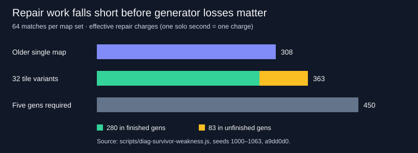

# Why survivors lose: chase execution and the team's time budget

Review date: **2026-11-16**. Code/maps measured at **`a9dd0d0dc43667a4c4332fdd319cadf04955e472`**. All new match experiments use deterministic seeds **1000–1063**, unless stated otherwise. This review preserves the owner's rules, solo-queue information limits, scoring, maps, and map generator. No runtime brain change is shipped: two deliberately small brain prototypes failed the full-match check.

## Summary

**The survivors neither extract enough time from chase resources nor turn the time they do have into enough finished generators. Evolution cannot invent the missing decision structure by adjusting the existing weights.**

1. **The quoted baseline and the evolution runs use different maps.** `matchup.js` defaults to the older `maps/gas-heaven.json`, whereas evolution uses `maps/gas-heaven/` with 32 variants. Defaults on the older map produce **3.984 kills, 0.016 escapes, 2.281 gens**; on the variants they produce **3.734 kills, 0.266 escapes, 3.109 gens**. Comparing the first to evolved populations overstates evolution's improvement and obscures a large map effect.
2. **Chase remains weak, including against the unassisted hunter.** The 190-case shack grid gives **19.17 s healthy / 9.59 s injured** against the strong harness, and **20.56 / 9.62 s** against the brain. Its all-start mean of 14.38 s mixes the two health states. Only **17%** of strong-harness window vaults are fast; **49%** of downs occur on open ground. The important remaining failures are route execution, retaining resources after a crossing, and correctly predicting both actors' temporary movement states.
3. **There are usually not three survivors doing gens during a chase.** On tile variants, there are **0.817 repairers** during HUD chase time, or **1.379 while all four are standing**. All three repair only **6.3% / 15.7%** of those respective periods. More chase time alone has a disappointing return at this productivity level.
4. **Repair falls short before regression is relevant.** Survivors spend **381.49 worker-seconds repairing**, worth **363.29 charges** after cooperation penalties, against a **450-charge** five-gen minimum. Only **279.84 charges** are in completed gens; **83.34** remain on unfinished ones. The default hunter does not kick unfinished gens (`kickMinProgress = 1`).
5. **Several apparent fixes are traps.** Allowing injured survivors to heal others increases healing but costs **0.734 completed gens**. Turning discretionary exploration off costs **0.766 gens**. Broadly trusting another survivor's chase does not demonstrably help. Fix the decision contracts and measure the combined time budget; do not ship these shortcuts.
6. **Owner-approved terminal rules amplify a losing position.** **46/64** tile-pool matches end by `allDown`, **15/64** by `lastSurvivor`. They account for **1.94 deaths/match** together. These are intentional rules, not bugs to silently remove; their statistics are not directly comparable to live DBD escape rates.

The requested 2-kill/2-escape outcome is a useful design target, not an established universal live-game baseline. BHVR's January–March 2025 data reported **60% kills overall and 63% at high MMR**, with powers, perks, items, hatch and normal live rules. It does not establish that five gens are usually completed at decent skill. [BHVR statistics](https://forums.bhvr.com/dead-by-daylight/kb/articles/503-stats-january-march-2025)

## Method and reproducibility

The following are new measurements, rather than numbers copied from previous reports:

```powershell
New-Item -ItemType Directory -Force scratch | Out-Null
node scripts/test-sim.js
node scripts/matchup.js --n 64
node scripts/diag-survivor-weakness.js --n 64 --map maps/gas-heaven.json --out scratch/legacy.json
node scripts/diag-survivor-weakness.js --n 64 --map maps/gas-heaven --out scratch/pool.json
node scripts/diag-survivor-weakness.js --n 64 --detail 1 --out scratch/detail.json
node scripts/duel-shack.js --out scratch/shack64.json
node scripts/duel-shack.js --n 190 --out scratch/shack190.json
node scripts/duel-shack.js --n 190 --hunter brain --out scratch/shack190-brain.json
node scripts/diag-rescue.js --n 32
node scripts/diag-idle.js --n 32
node scripts/diag-loops.js --n 16 --top 2
node scripts/diag-survivor-maps.js maps/gas-heaven
node scripts/diag-survivor-maps.js maps/gas-heaven.json
node scripts/diag-evolution-weakness.js --runs C:/Users/walte/dbd-hillclimb/runs --out scratch/evolution.json
```

`diag-survivor-weakness.js` observes engine state and wraps each survivor separately; it does not feed instrumentation back into brains. `--detail 1` imports an in-memory copy with a closure-state getter; the 64 per-seed outcomes, durations, repair totals and engine stats match the ordinary baseline. `--prototype` changes only the selected survivor factory in memory. No files under `src/` or `maps/` are edited. The full sim suite passes **1072 / 1072**.

The full-match table uses one older map or two cycles of the 32 variants. The rescue/idle samples cover each variant once; loop diagnostics use the first 16 seeds. Statistical uncertainty remains substantial for rare escapes. Knob ablations are paired by map and seed, not by post-intervention random decisions or encounter order. Where given, confidence intervals are approximate paired normal 95% intervals, not evidence of generalization to other maps or hunters.

Historical logs were read from the main checkout's **completed** `evo-v14` and `evo-v15` directories. Neither `runs/evo-v16` nor any running evolution was read, stopped or modified. These logs have no complete source snapshot, so historical outcomes are not a controlled benchmark of today's code. V14 also lacks some later knobs, including route lookahead and loop reversal. Their saved parameter spaces, rather than today's ranges, are used below.

## What good survivor play is trying to do

### Chase: spend resources to buy useful seconds

The basic loop is to preserve distance, take a tight path around cover, observe the killer at safe check spots, and use a window or pallet before the killer's attack can connect. Look behind while moving. Respect the **landing side**, not just distance to the window. Mindgames should respond to a killer's movement or stain; an unseen killer's last velocity is uncertain. Breaking LOS can buy a rotation or a transfer, but repeatedly vaulting the same opening is not a complete chase plan. Otzdarva's own resource index links his **All Tiles Explained** and **Survivor Beginner Guide**; the linked videos were located, but their transcripts could not be fetched, so no precise timing claim here is attributed to an unwatched video. [Otz resource index](https://www.otzdarva.com/), [tile guide](https://www.youtube.com/watch?v=E5QWNS14MS0), [survivor guide](https://www.youtube.com/watch?v=zbX0b8S9njQ)

Community advice consistently distinguishes using a safe loop from running between resources without extracting their value. Greed a pallet only when another rotation is safe or the killer respects it; pre-drop when the hit risk exceeds the value of saving it. Once a pallet is actually being broken, use the animation to reach another resource. Use an injury sprint to leave a weak tile, and chain tiles behind LOS blockers before the current resource is exhausted. Holding W is productive when the killer must follow and the destination remains safe; it fails when it merely deposits the survivor in a dead zone. These are practitioner heuristics, not guarantees of a 40–60 s chase on any shack start. [Looping discussion](https://www.reddit.com/r/deadbydaylight/comments/1vmfl1g/im_new_to_the_game_did_i_loop/), [resource chaining](https://www.reddit.com/r/deadbydaylight/comments/1vteret/need_looping_help/), [holding W and pallet respect](https://www.reddit.com/r/deadbydaylight/comments/1uk1gei/need_looping_help/)

### Generators: exploit the killer's single-target attention

One survivor occupying the killer enables the others to repair different gens. Separation avoids cooperation penalties and forces travel between objectives. Prioritize a dangerous central gen when feasible; do not leave only a compact defended three-gen. Finish valuable partial work when safe, but avoid concentrating all repairers where one approach interrupts everyone. Terror radius alone does not establish that the killer is targeting you. The HUD, visible approach, current distance, available escape route, health and generator progress should determine when to leave. [Player pressure discussion](https://www.reddit.com/r/deadbydaylight/comments/1x8ioqw/as_both_sides_how_do_you_ideally_gain_and/), [survivor game-sense discussion](https://www.reddit.com/r/deadbydaylight/comments/1kuk2xf/lesserknown_gamesense_tips_for_inexperienced/), [terror-radius advice](https://en.reddit.com/r/deadbydaylight/comments/1uu5ec8/i_cant_wait_to_play_for_the_first_time/)

The engine's 90 charges and per-worker **1 / .85 / .70 / .55** efficiencies agree with the relevant generator model. Two survivors take about **52.94 s**, spending **105.88 worker-seconds**; three take **42.86 s**, spending **128.57**. Grouping can finish an urgent gen sooner, but is inefficient for total output. Old advice to tap a kicked gen and immediately leave is obsolete: meaningful repair, **5% of its total charges**, is required to stop regression. [Generator rules](https://deadbydaylight.wiki.gg/wiki/Generator), [BHVR anti-three-gen/anti-tap update](https://forums.bhvr.com/dead-by-daylight/discussion/comment/3623490)

### Rescue, damage sharing and endgame

Leave one credible rescuer, keep other survivors productive, and allow the killer to commit elsewhere before rescuing when the hook timer permits it. Do not crowd the hook or bring chase back to it. A late rescue must account for travel and the unhook animation; a trade can be right to prevent death or exchange hook stages, but is poor when both players immediately go down. Healthy survivors can spend a health state during the killer's attack recovery to enable a save. Solo queue must infer roles through legitimate sightings, HUD continuity and intents; competitive comms are not available here. [Game-sense and rescue examples](https://www.reddit.com/r/deadbydaylight/comments/1kuk2xf/lesserknown_gamesense_tips_for_inexperienced/)

Open safe exits, avoid duplicate lever work, and judge a rescue by its likely additional escapes and remaining clock. Leaving a gate near completion can preserve rescue time before collapse, but is situational and can kill a chased survivor who needed an open exit. Perk-specific reasons to hold a gate are outside this simulation. [Situational endgame discussion](https://www.reddit.com/r/deadbydaylight/comments/1u2akvb/can_someone_explain_to_a_returning_player_why/), [Endgame Collapse rules](https://deadbydaylight.wiki.gg/wiki/Endgame_Collapse)

Competitive matches are useful for chase technique, not an interchangeable balance target: for example, the BHVR/Battlefy 2023 Community Cup used hook stages as the primary result, gens as a tiebreaker, and explicit perk/item restrictions. It used four-survivor teams, unlike our independently informed bots. [Published competition rules, pp. 1–2](https://cdn.battlefy.com/dead-by-daylight-community-cups/official-rules.pdf)

## Findings with measurements

### 1. The two map baselines must be kept separate

| Mean over 64 matches | Older `gas-heaven.json` | `gas-heaven/` variants |
|---|---:|---:|
| Kills / escapes | 3.984 / 0.016 | 3.734 / 0.266 |
| Completed generators | 2.281 | 3.109 |
| Match duration, s | 380.01 | 405.48 |
| Hooks / rescues | 7.48 / 4.56 | 7.83 / 5.13 |
| Downs / completed heals | 8.41 / 0.33 | 8.66 / 0.31 |
| Pallets dropped / broken | 5.88 / 3.31 | 4.77 / 1.16 |
| Pallets left standing | 5.13 of 11 | 11.70 of 16.47 |
| Fast share of window vaults | 11.7% | 29.5% |

This is a large map effect with identical brain defaults. Do not call the current tile-pool defaults a 3.98-kill baseline, or conclude that a v14/v15 generation outperformed defaults without replaying it on the same seed/map set against a fixed opponent.

### 2. Repair productivity is too low, not merely too slow



Tile-pool standing survivors accumulate **1151.47 survivor-seconds** per match. Mutually exclusive action bins are:

| Activity | Survivor-seconds/match | Share of standing time |
|---|---:|---:|
| Actual repair | 381.49 | 33.1% |
| Running outside the HUD chase | 444.17 | 38.6% |
| Walking outside the HUD chase | 6.76 | 0.6% |
| Moving in the HUD chase | 142.08 | 12.3% |
| Stationary in the HUD chase | 26.47 | 2.3% |
| Vaulting | 45.91 | 4.0% |
| Other idle | 82.08 | 7.1% |
| Explicit hiding/peeking while stationary | 4.61 | 0.4% |
| Healing, rescuing, mending, dropping pallets, opening gates | 17.90 | 1.6% |

These bins are observations, not labels of blame. Travel is necessary, and some non-HUD chase movement is real pursuit. Vaulting and interactions take precedence over chase/hiding in classification. The debug getter divides the **450.93 s** of non-HUD run/walk into **125.96 s work mode with an exploration target remembered**, **94.42 s brain chase mode**, **9.81 s sneak**, and **220.74 s other work/altruism travel**. The exploration number is a proxy: a remembered exploration target can persist through a higher-priority heal or rescue approach. Movement actions often do not identify their recipient; the instrument cannot precisely separate gen travel, exploration and altruistic detours without tagging the actual return branches.

Other idle includes **38.63 s holding a circuit entry/crossing in brain chase mode**, **0.49 s other chase idle**, and **42.95 s work-mode idle**. Thus a simple `hideTicks` counter misses most defensive time. Conversely, the first 30 s diagnostic reports only **3.1%** genuine no-interaction stillness, including **0.3%** teammate blockage. Generic collision unsticking is not the main early-game loss.

Cooperation costs **18.20 charges**, just **4.8% of raw repair time**. The 363.29 contributed charges leave 363.18 net stored charges; the 0.11 difference includes generator-completion overshoot and result rounding. There is essentially no default-hunter regression to explain the shortfall. At the observed efficiency, producing 450 charges would require approximately **472.5 raw repair seconds**, about **91 more** than observed, plus any additional losses or work stranded on unwanted generators. The **83.34 unfinished charges** are not all avoidable waste, but show that increasing total repair alone is not enough: finishing the right five matters.

| Repair concurrency during a HUD chase | Older map | Tile variants |
|---|---:|---:|
| Mean repairers, any remaining team size | 0.671 | 0.817 |
| No one repairing | 52.7% | 45.8% |
| Three repairing | 4.2% | 6.3% |
| Mean repairers while all four are standing | 1.144 | 1.379 |
| No one repairing, all four standing | 31.7% | 22.7% |
| Three repairing, all four standing | 10.9% | 15.7% |

The all-four-standing restriction matters: late-match incapacity makes a three-repairer target impossible. Even before that limitation, productivity is poor. A hypothetical 60 s chase yields only **49 gross repair worker-seconds** at the aggregate observed concurrency, before cooperation penalties; an ideal three-worker split yields 180. These are budgeting calculations, not promised gains from a patch.

**Code mechanisms:**

- `survivor.js:decideInner` puts any survivor seeing the hunter within `fleeSeenDist` into chase mode, regardless of another HUD chase. `trustChase` applies only to the unseen-hunter terror branch. A survivor outside the HUD chase but within 20 m of a seen hunter while another is chased has **23.68 survivor-seconds/match** of such exposure and **zero repair** during it. This is a targeted opportunity, not evidence all 23.68 s are safe.
- `withLook` always looks at a visible hunter, then a recent hunter, then a belief position under terror before it considers normal movement/glances. A survivor can keep looking back during repair travel and exploration; the engine requires camera perception to discover gens. At 60 s the sampled **standing** survivor knows only **2.58 of 7 gens** on variants. A task-aware camera sweep is a better candidate than changing camera rules.
- The exploration option competes with known gens every 5 s using broad unexplored-area value. `MapKnowledge.pickTarget` explores generic cells, rather than explicitly optimizing visits to public generator-candidate wrecks and useful connecting tiles. Yet removing exploration is harmful (see ablations): improve its destination value and interruption cost, do not suppress necessary discovery.
- Generator scoring has distance/progress/spread/threat weights, but no explicit remaining-three-gen patrol cost. The anchored teammate estimates already implemented in `MateTracker` are used by rescue, while gen selection relies on visible workers/headings. Reusing legal HUD-continuity memory can improve spread without inventing teammate positions.

### 3. Shack failures are still execution failures, with some previous problems already fixed

| Shack measurement | Strong harness, n=190 | Unassisted brain, n=190 |
|---|---:|---:|
| Healthy time to down, mean | 19.17 s | 20.56 s |
| Injured time to down, mean | 9.59 s | 9.62 s |
| Mixed-health time to down, mean | 14.38 s | 15.09 s |
| Fast / medium window vaults | 41 / 197 | 13 / 197 |
| Pallet dropped | 103/190 | 102/190 |
| Drop stuns | 97/103 | 96/102 |
| Open-ground downs | 93/190 | 78/190 |
| Downs mid-vault | 32/190 | 35/190 |
| Window blocked at least once | 23/190 | 24/190 |

The default 64-case command is **14.8 s**, matching the problem statement. For a balanced comparison use the full **38 setups × 5 seeds = 190**: the first 64 cases unevenly repeat the setup grid. Strong mode assists pursuit after 3 s blind, forces nearby dropped-pallet breaks, disables the cluster leash, and applies a pallet push-out workaround. Brain mode retains cluster neutralization and push-out by default but has no omniscient pursuit assistance. Its similarly short healthy and injured results rule out the assistance as the sole explanation. No measured scripted optimal survivor establishes the shack's attainable ceiling in this exact engine; **40–60 s remains an acceptance hypothesis**, not a sourced theorem.

The top residual code issues are concrete:

1. **The planning and execution models disagree.** `RouteEval.costs` prices every usable window as a 0.5 s fast vault. Real vaults are mostly 0.9 s medium. `LoopModel.tsOf` has a better incoming-leg approximation, but the movement controller still runs through side points rather than a validated, continuous run-up. The `runupPt` helper exists but is explicitly disabled (`const A = null`) because a prior detour version regressed results. Re-enabling that detour is not the fix. The planner must evaluate the path that will actually execute, including the required 2.5 m approach and its safety. The configured vault tiers are consistent with the documented live distinction. [Window timings and run-up](https://deadbydaylight.wiki.gg/wiki/Vault)
2. **Temporary speed and busy states are poorly represented in route scoring.** `RouteEval.vS` stays at 4 m/s through injury boost and unhook haste; `hunterSpeed` only accounts for Bloodlust. The caller supplies a delay for a visible pallet break, but not hit cooldown, stun or a committed hunter vault. `vaultSafe` separately recognizes `me.boosted`, so different decisions use different physical forecasts. On tile-pool full matches, measured path travel in the 1.8 s injury boost averages **8.31 m**, versus about **11.9 m** for unobstructed movement throughout it. This is an opportunity to spend a real speed advantage on the next resource, not a reason to buff the engine boost.
3. **Some hunter races use survivor navigation.** `api.nav` in this brain is survivor-bound. `landsBad`, the `hP/hQ` side checks and cutoff reversal compare `api.nav.dist(hp, point)` as though it were the hunter's path. That admits survivor window/pallet costs for the hunter. `RouteEval` already has a distinct hunter field; use consistently role-correct travel times, with explicit uncertainty when sight is lost. This is a code-model mismatch; its isolated outcome effect is not measured.
4. **Circuit commitment and holding are brittle.** After a crossing, `committed` remains true while a circuit exists, so ordinary route re-evaluation is bypassed. The remaining runner handles several cases but may hold when the hunter is unseen or on the opposite side, rather than comparing a safe continuation, an alternative direction, and a transfer. The measured **65.1 s/match** stationary in brain/HUD chase holds is a warning. Some of that time is legitimate distance management; trace it before deleting all holds.
5. **The open-route rollout is only a proxy for execution.** `RouteEval.path` descends to any neighboring lower field value without enforcing the predecessor edge's movement legality/cost. The field forbids certain diagonals and corner cuts that this descent can accept. Fields use cell topology, not the engine's complete swept-circle trajectory. Rollouts also use a fast-window price regardless of how a path approaches. Add a predecessor/edge-consistent path and validate representative corner/run-up paths against real motion before tuning more route weights.

**Reproducible trace:** `node scripts/duel-shack.js --trace 8 --every 1` (seed 1008). The healthy survivor enters the north door and fast-vaults at **1.5 s**, reaches the east landing point and stays there around **2.9 s**, then runs a series of open-ground destinations. It is hit at **6.8 s**, gains a gap of **14.83 m** by the post-hit sample, but goes down along the south/east wall at **15.6 s with the pallet still up**. No hunter assist was used in this duel. The failure is not a missing speed boost or unavailable pallet; it is failing to convert the available distance into a sustainable next route.

Do not simply repeat the old `shack-duel.md` recommendations. Current code already observes visible pallet breaks, removes the breaking pallet from plans, checks landing-side risk, reacts to visible hunter vaults and tracks actual survivor crossings. In the new strong grid, survivors are **11.20 m** from the pallet when its break completes, and only **17/97** break cases down them within 3 s. The old report's **3.15 m** break distance describes an earlier implementation. `loopReverseDist`/`loopReactS` and route-lookahead knobs also already exist.

### 4. Ordinary chases fragment; do not equate an eight-second HUD segment with a full chase-to-down

Across the tile-pool matches there are **1225 closed HUD chase segments**, averaging **9.42 s**, median **5.8 s**, 90th percentile **22.5 s**. Mean end counts per match: **8.08 switches**, **7.44 downs**, **2.30 range losses**, **0.80 carry transitions**, **0.53 LOS losses**. The switch-heavy HUD makes segment duration a misleading sole KPI.

`diag-loops` separately tracks time from each chase start to the target's next down, capped at 60 s. Over its 16-map sample, that is **45.9 s** near the special multi-window tile and **37.4 s** elsewhere, versus HUD segments of 10.5 / 8.5 s. Some samples are censored or include a break in pressure; neither metric is pure continuous pursuit. Future chase fixes should report **healthy/injured first-contact-to-down, segment duration/reason, and teammate repairs earned**, together.

On the tile pool, **61.4%** of downs are within 4 m of a window/pallet, and **42.6%** are within 16 m of the map boundary. On the older map the corresponding values are **42.9% / 70.1%**. A nearby resource is not necessarily reachable or safe; nonetheless these numbers reject a universal explanation that survivors only lose because no resources exist.

### 5. Health recovery has a coordination deadlock, not just low altruism

Defaults complete **0.31 heals** despite **5.13 rescues/match** returning survivors injured. There are **32.05 survivor-seconds/match** where an action requests `heal` but no healing starts. At end-of-tick classification, **28.92 s** coincide with the intended patient still repairing, and **2.65 s** with the patient moving.

The engine intentionally requires the patient to be idle. The patient only automatically stops when the HUD says `beingHealed`. The HUD flag is set from an actual healing interaction; an attempted heal rejected because the patient is repairing never establishes it. Thus the healer can stand next to a repairing patient and repeat an impossible action. This is a brain handshake problem under the approved rules. Only healthy survivors initiate healing in defaults, and injured `seekHeal` patients also only seek healthy teammates; the team can lose all recovery initiative once everybody is injured. Downed-with-only-injured-standing configurations persist **27.18 match-seconds/match** before terminal rules resolve the situation.

Correct recovery requires a safe, local acceptance mechanism: a healer signals the existing `healing` intent and approaches a **visible** patient; the patient may pause briefly when that nearby teammate plausibly intends a heal; both abandon an unproductive rendezvous after a short timeout. A global intent must not encode a target or reveal positions. Permit injured survivors to pick up a recovered slug, but prioritize the urgent recovery over arbitrary injured-to-injured healing and keep the patient's availability contract explicit. Healing everyone at every opportunity consumes two people's time and is not automatically good macro play.

### 6. Rescue is imperfect, but immediate hook trading is not the dominant loss

The separate 32-map rescue diagnostic finds **199 rescue opportunities**:

- **160 rescued (80%)**, no self-unhooks; **5 actual hook-timer deaths (3%)** and **34 terminated by other match-ending conditions**.
- Median first decision to go: **11.7 s after hook**. Median unhook: **29.4 s after hook**. This is not generally an immediate-unhook panic.
- **1.20 goers/opportunity**; 53 opportunities have 2+ people go at some point (**27%**). Maximum simultaneous goers: 0 / 1 / 2 in **21 / 146 / 32** opportunities. Sequential goers and simultaneous crowding are different.
- First goer is closest when committing in **84%** of cases; the actual rescuer is closest in **85%**. Mean extra path against the closest candidate is only **1.2 m**. The present utility planner already improved basic distance choice.
- Rescuer or rescued downed within 10 s: **3/160 (2%)**. Full 64-map instrumentation finds **9/328 (2.7%)** by the same short-window definition. This does not count later tunneling or rescues that lose productive time without causing an immediate down.

`rescue.js` already supports claims, closest-survivor uncertainty, urgency, camp risk and busy-killer bonuses. Improve claim expiry when a claimant is interrupted, and make deadlines include travel **plus** rescue animation and a safety margin. It currently rejects an impossible struggle save only when `travel > remaining + 0.5`, and urgency is based on elapsed stage time. Avoid replacing this system wholesale or concentrating the next optimization cycle on trades that explain only a few percent of rescues. Brain chase and gate logic run before rescue; endgame survivors open/leave rather than explicitly weighing a save. Address endgame altruism after the team reliably reaches five gens.

## Paired ablations: attractive shortcuts that failed

All rows use **64 tile-pool matches, identical seeds and default hunter**, with no engine changes.

| Survivor intervention | Kills | Gens | Effective repair charges | Heals | Interpretation |
|---|---:|---:|---:|---:|---|
| Baseline | 3.734 | 3.109 | 363.29 | 0.31 | Reference |
| Allow injured survivors into existing healing branch | 3.781 | 2.375 | 311.32 | 1.78 | More recovery, substantially worse objectives |
| Ignore visible-hunter flee/hide trigger beyond 10 m while another is chased and `trustChase` is on | 3.828 | 2.844 | 343.67 | 0.52 | Broad suppression does not deliver safe productive work |
| `exploresMap=0` | 3.859 | 2.344 | 300.69 | 0.45 | Removing discovery and distribution hurts |
| `seekHeal=1` | 3.688 | 2.984 | 357.83 | 2.31 | Resolves most blocked healing, no clear escape improvement |

The injured-heal prototype's paired gen delta is **−0.734 [−1.092, −0.376]**; discretionary exploration off is **−0.766 [−1.239, −0.292]**. The work-during-chase prototype is **−0.266 [−0.705, +0.174]** gens and **+0.094 [−0.123, +0.311]** kills. `seekHeal=1` is **−0.047 [−0.299, +0.206]** kills: it is not demonstrated to improve survival. Its failed-heal requests fall from 32.05 to **0.66 s**, establishing a local mechanism without establishing a good global policy.

Reproduce with the preceding diagnostic command and one of:

```text
--prototype injured-heal
--prototype work-during-chase
--sp exploresMap=0
--sp seekHeal=1
```

The second prototype only suppresses the two current triggers, retaining mode hysteresis, existing route choices and the 10 m emergency flee behavior. It does not implement a time-to-contact objective policy. These are falsification experiments, not finished fixes. No prototype is installed as a default.

## Evolution: what changed, where ranges bind, and what the logs cannot prove

Each run has **40 generations**, population **24 per side**, **8 matches/genome/generation** (192 matches total), elite fraction **0.5**, mutation probability **0.3 per knob**, and Gaussian sigma **0.12 of range**, with crossover. The hunter and survivor co-evolve against changing opponents and changing random seeds. Both runs use GA seed 1, but different brain spaces/implementations; they are not independent controlled repetitions.

| Logged population outcomes | V14 first 10 → last 10 gens | V15 first 10 → last 10 gens |
|---|---:|---:|
| Kills | 3.811 → 3.672 | 3.895 → 3.804 |
| Escapes | 0.185 → 0.326 | 0.105 → 0.196 |
| Completed gens | 1.990 → 2.831 | 1.757 → 2.154 |
| Total gen equivalents, including partial | 3.135 → 3.912 | 2.915 → 3.668 |
| Duration, s | 434.0 → 465.0 | 391.6 → 446.2 |
| Time-weighted survival score | .280 → .309 | .245 → .280 |
| Mean survivor BP | 8029 → 9680 | 7259 → 8724 |

There is progress, including delayed losses, but not convergence on the desired survivor outcome. These are **population means**, not fixed-opponent champion validation. V14's late gen total is also lower than today's tile-pool defaults, but that alone does not prove its evolved survivor is worse: opponents and implementation differ.

### Interpretable drift

Values below are **late-10-generation mean population medians**, except stated first/final values.

- Both populations suppress terror walking: `walkWhenTR` **.28 / .33**, on the running side of its `.5` switch. Both enable `seekHeal` (**.82 / .63**) and reduce `downedStillDist` (**6.32 / 4.62** versus default 12), consistent with escaping the healing deadlock and recovering instead of crawling unnecessarily.
- V14 lowers `fleeSeenDist` from initial 20 to final **9.81**, with late median **12.17**; V15 remains near **19.47**. `fleeTR` late medians **3.28 / 10.61** map to different discrete terror-layer reactions, not continuously different caution.
- V14 increases `spreadW` to **1.90**, `genJitter` to **1.15**, `loopTravelMaxM` to **48.75**, `chaseFromHookW` to **.82**, and `loopScoutW` to **1.92**. It is searching for distribution, resources, and separation from hooks.
- V15 also strongly prefers fleeing away from hooks (`chaseFromHookW` **.99**) but selects near-zero pallet greed (**.11**), border preference (`edgeAvoidW` **−.97**), and a long exploration scale (**79.69 m**). Some selected behaviors are plausible compensations for weaknesses elsewhere, rather than desirable universal strategy.
- The runs disagree sharply on `palletGreed` (**2.66 / .11**), `hideDist` (**7.06 / 67.34**), `holdMaxS` (**12.43 / 2.60**), `chaseToMatesW` (**+.88 / −.35**) and `genProgW` (**1.13 / .05**). Forty generations have found different coupled local policies, not a stable meta prescription.

### Edge pressure: candidates for experiments, not automatic range expansion

“Edge share” means the fraction of all individuals over the last ten generations within **5% of the saved bound**. Gaussian mutation plus clamping creates exact-bound masses, so pinning alone does not prove a too-narrow range.

| Run / knob | Late edge share | Meaning / next experiment |
|---|---:|---|
| V14 `spreadW` upper 2 | 57% | Try a wider positive spread penalty against fixed opponents |
| V14 `loopTravelMaxM` upper 50 | 68% | A range increase alone is ineffective: route fields are bounded (survivor radius 34 m) |
| V14 `loopScoutW` upper 2 | 55% | Test targeted resource scouting, with exploration cost logged |
| V14 `peekW` upper **3** | 78% | Saved range differs from today's upper **8**; already widened in current code |
| V14 `mateSpread` lower .2 | 59% | Test calibration of uncertainty; do not assume teammate fixes remain exact |
| V14/V15 `hideThreat` upper 1.05 | 95% / 67% | Usually selecting **off**, not requesting a larger probability threshold |
| V14 `avoidHeading` upper 1 | 73% | Boolean-like `>.5` switch; expanding above 1 adds no new behavior |
| V15 `chaseFromHookW` upper 1 | 78% | Strong candidate for a wider away-from-hook preference |
| V15 `exploreRadM` upper 80 | 72% | Candidate for wider search scale or improved objective-aware search |
| V15 `palletGreed` lower 0 | 83% | Existing minimum already permits no saving bonus; negative greed is not the obvious fix |
| V15 `edgeAvoidW` lower −1 | 71% | Investigate map/escape-route dependence before rewarding borders more |
| V15 `farFromHunterW` lower 0 | 93% | Disabling a term; possibly redundant with `hunterAvoidW`/belief threat |
| V15 `openGroundPenalty` lower 0 | 79% | Added anti-dead-zone term was selected off; inspect rollout/value interaction |

V15 also crowds lower bounds for `glanceRate` (63%), `loopScoutW` (67%), `hideMoveMaxM` (78%) and `hideHoldS` (68%). In V14, `glanceRate` crowds the opposite bound (51% upper). These differences are evidence against prescribing one extreme from one evolutionary trajectory.

### Wandering and inactive knobs

V14 late median ranges cover **53% of the range for `genClusterW`**, **47% for `rescueBusyBonus`**, **45% for `hideHoldS`**. V15 has **46% for `coverRun`**, **42% for `loopReactS`**, **39% for `peekMoveMaxM`**. This is wandering, not proof of uselessness: the outcome samples are noisy and knobs interact. In particular, hiding-off genotypes render many hiding parameters nearly inert; loop reaction only matters when reversal is enabled and triggered. Several float knobs are actually thresholds (`>.5`, `>.25`, etc.), so much of a nominal continuous space has identical behavior. `fleeTR` is also quantized by three heard midpoints.

Add per-branch activation counters and frozen-opponent ablations before deleting a wandering knob. Widen only behaviorally meaningful, reproducibly selected bounds. Use categorical/boolean mutation for switches, conditional mutation for gated subpolicies, and fewer simultaneous behavioral changes in late search. An unchanged or narrow median can also be genetic hitchhiking; it does not establish a causal mechanism.

The existing survivor objective is **half normalized BP plus half integrated hook-stage survival**, using a 1200 s horizon; it is not just match win rate or raw lifetime. It already rewards teammates' objective work during chase through chase-share BP, and short unsafe rescue BP is withheld. `hunterscore.js` makes any 4k worth **95–100**, regardless of the amount of partial gen work. These owner-approved rewards have different gradients: delaying a loss, earning stuns, or safely farming rescues can improve the survivor score without completing five gens. Do not silently replace them; report escapes, complete/partial gens, repair productivity and hook burden alongside fitness. Any stronger team-outcome component is an owner decision.

## Engine and map audit: discrepancies and questions for the owner

The reviewed rules are authoritative. The following separates intentional departures, uncertain 2D translations, and brain misuse. This review implements none of them.

| Area | What is present | Assessment / owner question |
|---|---|---|
| Base speed | Survivor 4, hunter 4.6 m/s; carrying 3.68 | Standard basic-killer baseline; no evidence for a blanket survivor speed buff |
| On-hit escape | 6.6 m/s for 1.8 s, 2 s no-collision | Sourced movement values are already present; fix how the brain spends them. [Movement table](https://deadbydaylight.wiki.gg/wiki/Movement_Speeds) |
| Vault/pallet timings | .5/.9/1.5 s window; hunter 1.7; rushed pallet 1.1; drop .3; break 2.34; stun 2 | Broadly consistent documented values. Timers quantize at 0.1 s; 2.34 becomes 2.4. Planner's fixed fast-window assumption is a brain error. [Windows](https://deadbydaylight.wiki.gg/wiki/Vault), [pallets](https://deadbydaylight.wiki.gg/wiki/Pallets) |
| Attack | .35 s rounds to .4; 2.2 m endpoint fan ±45°; lunge ×1.5; cooldown 2.7/.575 and miss 1.5/1.15 | A deliberately simplified attack envelope, including mid-vault hits. Calibrate scripted corner/vault duels before changing range; ordinary visual ray visibility is also required, which can favor survivors behind layered semi-cover. [Attack mechanics discussion](https://deadbydaylight.wiki.gg/wiki/Talk:Attacks) |
| All down | Immediate death of everyone still in the match when none stands | Intentional; 46/64 pool matches and 1.703 deaths/match. Suppresses any remaining bleedout/carry/Resolve resolution. Keep as requested, but separately report state at termination |
| Last survivor | Instant death before gates powered; no hatch | Intentional; 15/64 pool endings, .234 deaths/match. This removes live-game comeback escapes. Hatch remains out of scope; calibrate two-escape targets independently of last-player escape statistics |
| Body/corner geometry | Same 0.4 m circles for both roles, 1 m grid, static nav plus body blocking | Does not reproduce every human tight-loop/hitbox advantage. No verified live radius supports a numeric replacement here. Measure exact corner travel and collision first |
| Terror and survivor info | 32 m, delayed coarse layers; camera 100°; no hidden gen auras; only approved HUD/intents | Preserve these constraints. Terror is not a targeting indicator. Task-aware looks and legal memory are brain work, not additional info |
| Red stain / movement sounds | No survivor red-stain footprint or close killer footsteps; screams off | Potentially makes blind-corner mindgames harder for survivors; also many survivor noises are absent, benefiting stealth. Existing missing-mechanics backlog already flags these. Ask whether a locally visible stain is desired; never expose true hidden hunter coordinates. [Red stain](https://deadbydaylight.wiki.gg/wiki/Stain) |
| Hunter knowledge | Knows selected gen positions, global completed gens and public static map/spawn rules; progress/workers only when perceived; repair noise 20 m; scratch/grunt/noise belief updates | Code inspection found no general wallhack feeding true survivor positions into ordinary hunter planning. The strong **duel harness** does have an explicit assist. A strong spawn prior in `belief.js` is an inference from public rules, not a new engine sensory channel |
| LOS | 75 m deterministic cone/rays; one low obstacle visible, two hide; grid masks for props | Exact detection is more reliable than human recognition, but both roles get deterministic perception and survivors get camera peeking. No measured case establishes this as the dominant imbalance |
| Re-vault constraint | No fast re-vault within 2 s after hunter clears the same window | Explicit user rule; it can make shack reverse play less effective than an arbitrary live guide. Preserve it and test controller policies within it |
| Healing / anti-camp | Idle patient required; Resolve pauses near teammates/chase; 70 s stages; protections present | Brain coordination must obey these. Do not reapply old missing-mechanics gaps already fixed. Nearby rescuers can suppress Resolve; do not encourage indefinite hook crowding |
| Generator sampling | Seeded 7 of candidates, no additional spacing optimization at selection | Audit distributions after tile work; avoid tuning to one fixed central multi-window probe |

**Map facts, with no map edits:** Both older map and variant outline area are **9984 m²**. Across the 64 selected variant matches there are **14–22 pallets (mean 16.47)** and **15–25 windows (mean 19.09)**, versus **11 / 7** on the older map. All selected generators in this sample have **four repair slots**, so inadequate repair sides do not explain the result. A lightweight static audit using hunter nav between each selected gen's north repair slot gives mean closest-pair path **22.96 m** (range **13.90–33.07**), and minimum three-gen closed-tour path **96.27 m** (range **62.28–132.08**); older map values are **26.29 / 112.54 m**. Slot-to-slot path distance is a reproducible proxy, not exact optimal patrol distance. A 62 m tour is about 13.5 s at base hunter speed before stopping/interactions; it is worth logging how frequently such a cluster remains at four completed gens. No universal live-map spacing threshold is asserted.

The special multi-window tile is a confounder: in the 16-match loop diagnostic, **44.4%** of chase window vaults occur inside it. The geometric model assigns its top circuit **41.0 m held/chase**, versus **15.0–19.2 m** for the best circuit elsewhere on three sampled maps. Full-anchor-knowledge duel probes can survive about **42 s** both there and at the best non-probe circuit, often hitting the 60 s cap. Those probes alter knowledge and start geometry and do not establish the isolated shack ceiling. They do show useful map resources exist and that resource discovery/entry matters. Coordinate map validation with the concurrent tile work, then rerun on a frozen map set.

## Ranked recommendations

“Impact” below is engineering judgment from the measured opportunities, not a measured effect size of an unimplemented patch.

| Rank | Concrete next change | Expected impact and evidence | Knobs / validation |
|---|---|---|---|
| **1** | **Make chase plans executable and physically consistent.** Use actual run-up paths and vault tier; role-correct hunter travel; time-varying injury boost/haste and visible cooldown/stun/vault delay; legal path predecessors. After a crossing, compare safe continuation, reversal and next-resource transfer instead of latching indefinitely. Track unseen hunter uncertainty | **Very high potential.** Healthy shack survival ~19 s; medium vaults dominate, open ground accounts for 49% of downs, and 61% of full-match downs are near resources | First fix model correctness rather than adding more weights. Then consider `transferMarginS`, `holdRiskS`, `healthyHitBudget`, and a transfer commitment duration. Keep injured/healthy duels separate; require improvement against unassisted and assisted hunters and full matches |
| **2** | **Optimize productive time with a task-aware objective policy.** Search public candidate wrecks and connecting resources; put explicit cost on abandoning a promising gen; make camera looks sample the route/objective; use legal anchored teammate memory; choose between staying, short pre-run to a safe tile, and repositioning by time-to-contact | **Very high potential, paired with #1.** ~91 more raw repair seconds are needed at current efficiency; 126 s travel with a remembered exploration target and 94 s non-HUD brain-chase movement deserve branch-level tracing | `repairAbandonMarginS`, `genCommitS`, `candidateSearchW`, `taskGlanceS`, `repairersTargetW`. Do not disable exploration or merely trust all other-chase flags: both tested shortcuts failed. Track all-four-standing concurrency and charges in unfinished gens |
| **3** | **Repair the local healing/recovery contract.** Visible approach plus existing intent, recipient acceptance/brief pause, cancellation timeout; allow injured rescue of a recovered slug; distinguish urgent recovery from optional reset; compare heal cost to nearby objective completion | **High structural value; outcome benefit unproven.** 29 s/match wasted on a repairing patient; almost no heals; all-injured states cannot initiate recovery. Blanket permission materially regressed gens | `healOfferS`, `healAcceptDist`, `healAbortS`, `resetThreatMargin`, `slugRecoveryPriority`. Validate fewer invalid attempts **and** preserved objectives/escapes; `seekHeal=1` alone is not a demonstrated win |
| **4** | **Make evolution evaluations interpretable.** Freeze maps per experiment, paired common seeds, held-out seeds, fixed default plus archived hunters; evaluate champions in a cross-play matrix; log branch activation and chase-to-team-objective conversion. Reduce effective search dimensionality before widening ranges | **High confidence as a research improvement.** Only 8 noisy games per genome, moving opponents, many conditional/threshold knobs; runs select conflicting policies | Keep approved fitness. Optionally ask owner about stronger team-outcome shaping. Widen spread/away-from-hook/search ranges only after fixed-opponent sensitivity checks; account for route-field caps |
| **5** | **Improve rescue claims/deadlines and danger-aware allocation**, using the existing planner. Expire interrupted claims, include travel + interaction + safety in deadlines, keep extra survivors working, avoid bringing chase to hook | **Medium.** Some duplicate goers (27%), but only 2–3% short-window trades and most actual rescuers are closest | `rescueArrivalBufferS`, `claimRefreshS`, `claimStallS`; cap simultaneous goers while retaining fallback saves. Compare hook-stage losses and productive repair seconds, not just rescue count |
| **6** | **Add a known-gen spread/endgame plan.** Score the remaining generator cluster using only discovered positions, finish dangerous partials when feasible, allocate levers from own sightings/HUD continuity, then weigh endgame saves | **Medium later, lower immediate priority.** Current baseline rarely reaches gates; 83 charges remain partial. No explicit gen-choice three-gen term; gate branch precedes rescue | `remainingClusterW`, `finishRiskW`, `endgameSaveMarginS`. Never reveal unknown gens or assign teammates from global positions. Validate on naturally reached endgames and a labeled short-gen diagnostic |
| **Owner / map track** | **Calibrate rule and geometry comparability without changing rules under this review.** Report pre-terminal states, scripted attack/vault/corner tests; decide on stain/audio; freeze replacement tiles and measure spacing/resource reachability | Potentially large but **not a substitute for the observed brain failures**. Terminal rules account for ~1.94 deaths/match; geometry strongly changes the baseline | Separate balance target, sensory-rule decisions, and map validation. No map or mapgen edits here; no hatch/powers/perks/skill-check expansion |

For the next iteration, the meaningful success criterion is a matched-seed increase in **healthy/injured chase-to-down time plus teammate effective repair and completed gens**, with no regression in the 1072 sim checks. A chase improvement that merely transfers idle time to three other survivors, a heal policy that farms health-state events, or an evolution score increase against a weaker contemporary opponent is insufficient evidence of progress.

## Sources and limitations

External sources were accessed on 2026-11-16. Wiki.gg sometimes returned 403 on direct fetch, so indexed excerpts were used; exact undocumented radii/animation curves are explicitly not asserted. Reddit supplies first-person strategy discussion, not authoritative constants. The live-game numbers cannot isolate perks, powers, items, premade comms or hatch; the owner-approved simulation deliberately omits or changes those. No Hens transcript was available to substantiate a specific Hens claim, so none is invented.

- [BHVR January–March 2025 outcome statistics](https://forums.bhvr.com/dead-by-daylight/kb/articles/503-stats-january-march-2025)
- [Otzdarva's curated beginner/tile resources](https://www.otzdarva.com/), [All Tiles Explained](https://www.youtube.com/watch?v=E5QWNS14MS0), [Survivor's Guide](https://www.youtube.com/watch?v=zbX0b8S9njQ)
- [Wiki generator rules](https://deadbydaylight.wiki.gg/wiki/Generator), [BHVR anti-tap/three-gen update](https://forums.bhvr.com/dead-by-daylight/discussion/comment/3623490)
- [Wiki windows/vaulting](https://deadbydaylight.wiki.gg/wiki/Vault), [pallets](https://deadbydaylight.wiki.gg/wiki/Pallets), [movement](https://deadbydaylight.wiki.gg/wiki/Movement_Speeds), [attack discussion](https://deadbydaylight.wiki.gg/wiki/Talk:Attacks), [red stain](https://deadbydaylight.wiki.gg/wiki/Stain), [collapse](https://deadbydaylight.wiki.gg/wiki/Endgame_Collapse)
- [Community Cup rules](https://cdn.battlefy.com/dead-by-daylight-community-cups/official-rules.pdf)
- [Survivor game sense/rescue timing](https://www.reddit.com/r/deadbydaylight/comments/1kuk2xf/lesserknown_gamesense_tips_for_inexperienced/), [team pressure](https://www.reddit.com/r/deadbydaylight/comments/1x8ioqw/as_both_sides_how_do_you_ideally_gain_and/), [loop resource use](https://www.reddit.com/r/deadbydaylight/comments/1vmfl1g/im_new_to_the_game_did_i_loop/), [chaining](https://www.reddit.com/r/deadbydaylight/comments/1vteret/need_looping_help/), [holding W/pallet respect](https://www.reddit.com/r/deadbydaylight/comments/1uk1gei/need_looping_help/), [terror radius](https://en.reddit.com/r/deadbydaylight/comments/1uu5ec8/i_cant_wait_to_play_for_the_first_time/), [endgame choices](https://www.reddit.com/r/deadbydaylight/comments/1u2akvb/can_someone_explain_to_a_returning_player_why/)

Local evidence: `src/sim/{README.md,config.js,match.js,nav.js,sight.js}`, `src/brains/{survivor.js,routes.js,loops.js,lookahead.js,tileplay.js,rescue.js,matetrack.js,hunterbelief.js,mapknow.js,hunter.js,belief.js,loopmind.js}`, `src/hillclimb/{evolve.js,worker.js,hunterscore.js,bloodpoints.js,params.js,maps.js}`. Existing `missing-mechanics.md` is a historical backlog: many entries have since been implemented. Current config and executable behavior take precedence when identifying what is already present.

Log SHA-256: v14 `9d99103431ea56701d738183f952906eea14f471608f0d872a7f87dd519bb7e2`; v15 `3556849677f4e6bef30f8e4c42b07443cad48df6f972aee137cecfe5f25935b7`. Raw scratch outputs are deliberately uncommitted; the diagnostics reproduce the numerical evidence.
